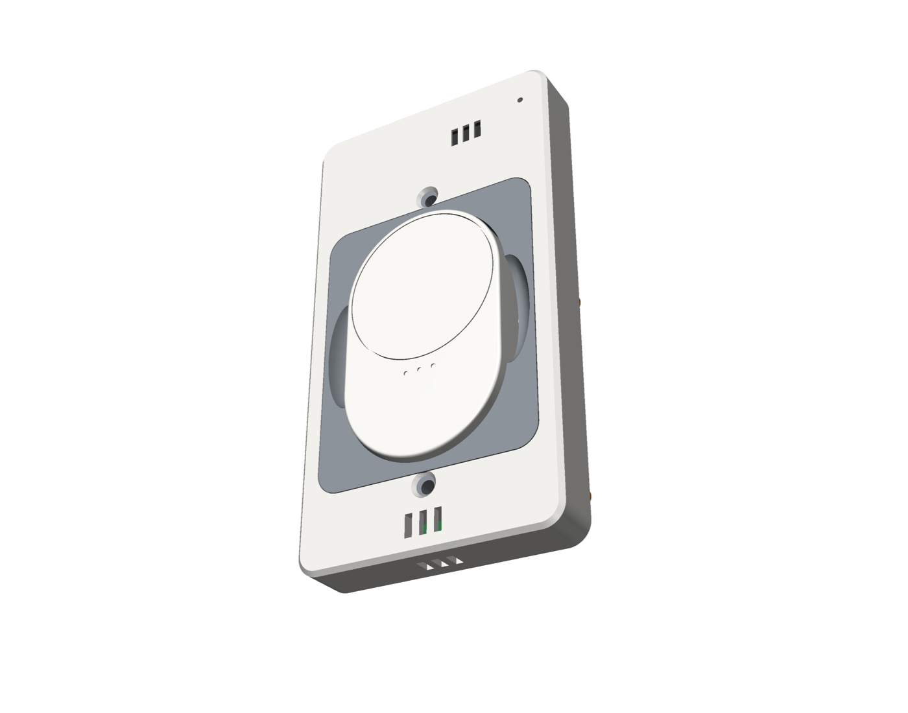
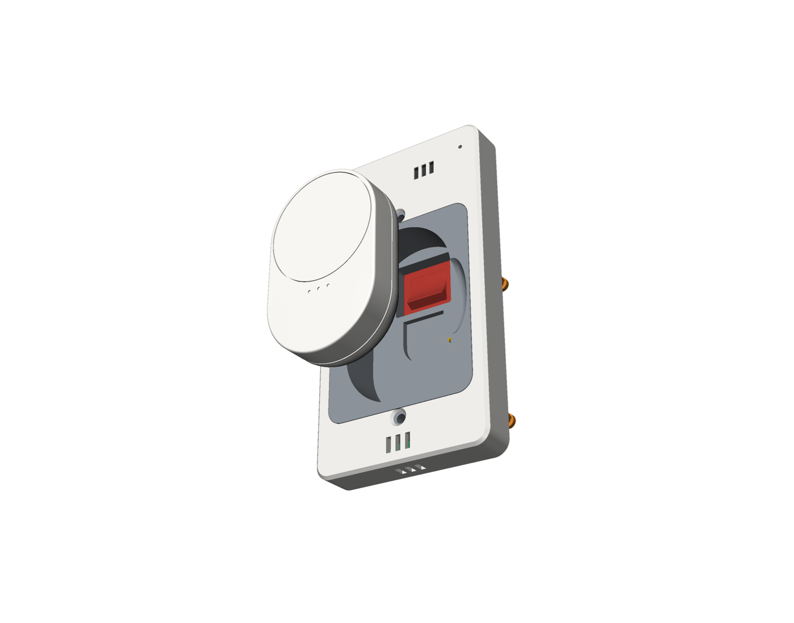
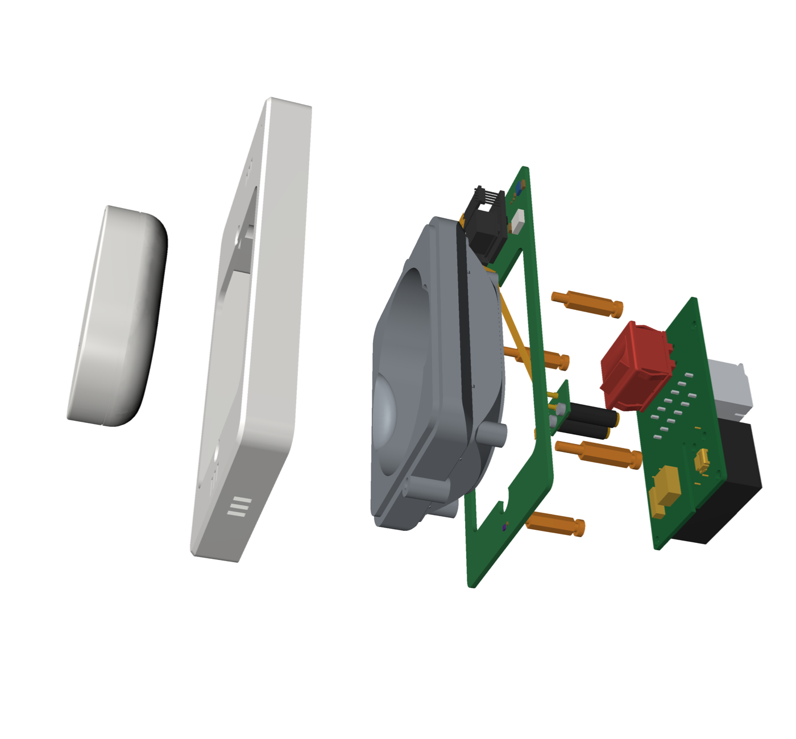
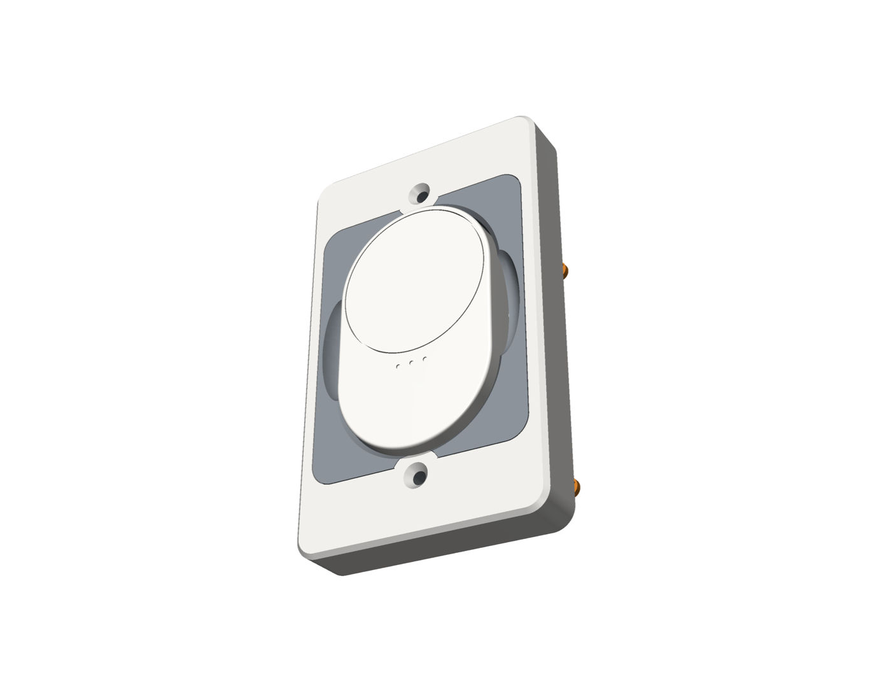
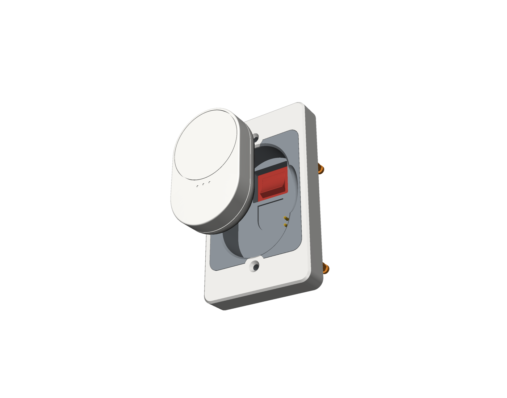
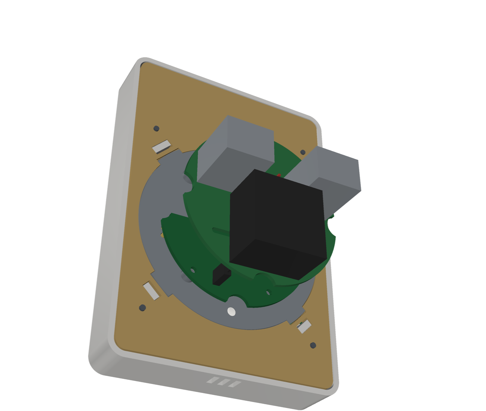
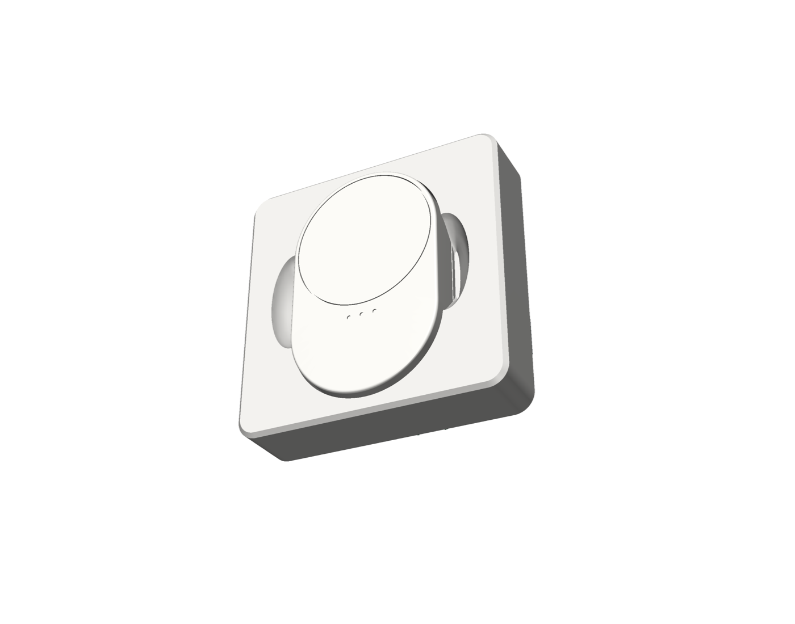
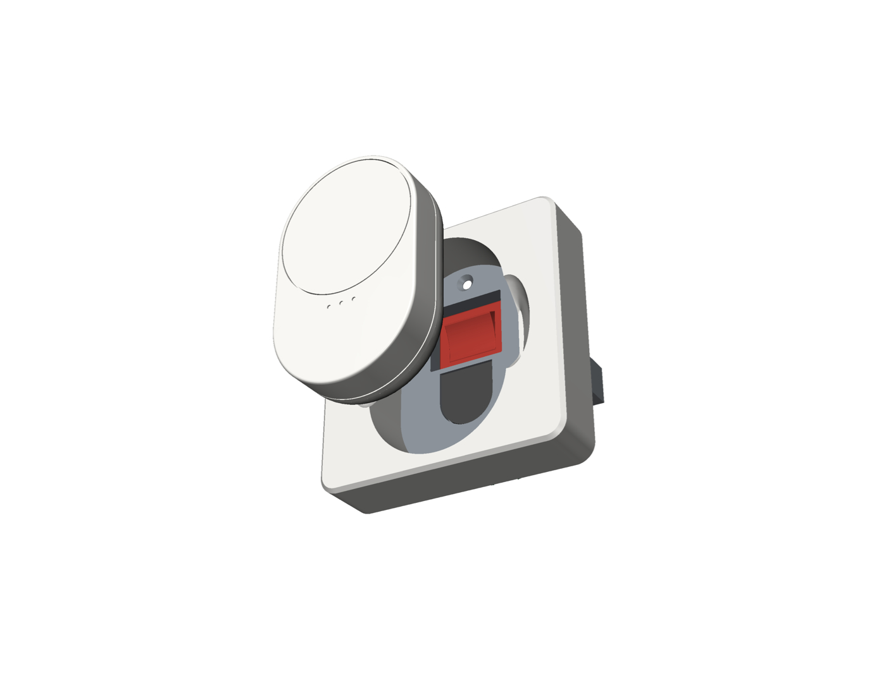

# Sladdseg

Sladdseg is a wall plate that replaces a light switch on a circuit where every bulb is a smart bulb (here IKEA
Matter-over-Thread). The bulbs stay powered. An IKEA BILRESA scroll-wheel remote sits recessed in the plate and lifts
out; behind it a rocker switch cuts line and neutral to the circuit. The full edition adds mmWave presence,
temperature, humidity and push-to-talk voice at the switch location, powered from the box.

| North American single-gang (Decora) | European round flush box (DIN 49073) |
| --- | --- |
|  |  |

Two variants, equal in every respect: **NA** for a 2 × 3 in single-gang box, **EU** for a Ø60 / 68 mm round flush
box. Printed parts and small PCBs, all generated from this repository.

**Status: v0.7, design and test-print stage.** The PCBs have not been ordered and no plate has been energised.
Nothing here is certified or code-compliant. Read [`docs/SAFETY.md`](docs/SAFETY.md) before building anything.

## Why a custom plate

A wall switch in series with a smart bulb cuts its power, so the bulb drops off the network and out of every
automation. What is on the market was looked at first ([`docs/DESIGN.md`](docs/DESIGN.md), D-1 to D-6):

- Inovelli's Blue mmWave dimmer (Zigbee, smart-bulb mode) comes closest. It has no humidity sensor and no mount for
  the remote.
- Stand-alone presence sensors (Aqara FP300, Everything Presence Lite) are too big for a switch location and have no
  climate sensing. IKEA's own sensor is PIR.
- A Shelly relay behind a conventional switch adds a second controller to bulbs that already have one.
- Designing mains switching electronics, or putting Li-ion cells in the box, was ruled out: approved-equipment rules,
  heat, fire risk.

The design that follows from that:

- The remote is the control. The BILRESA sits recessed in the plate, 2.6 mm proud, held by its magnet on a piece of
  the steel plate IKEA supplies with it.
- The rocker is the fallback. A hidden DPST rocker breaks line and neutral to the lighting load. Off and on, with the
  bulbs' power-on state set to "On", gives light when Home Assistant is down. Off also de-powers the plate's
  electronics.
- Nothing on the mains side is designed here. The rocker (Marquardt 1802.2504 or E-Switch RA412C1100), the 5 V
  supply (Mean Well IRM-03-5 for NA, Zettler ZPI03S0500WC for EU) and the terminal blocks (WAGO 2604) are bought in
  with their marks. The board they sit on is designed to IEC 62368-1 spacing targets, for human review.
- Cost, parts and PCBs per plate in USD: a full NA plate about 111 at one and 38 at a hundred, plus the MSR-2 at
  38 to 58 retail; a switch-only plate 21 at one and 10 at a hundred. EU runs a little lower. Details under Cost.

## Three editions

| Edition | Contents | NA face plate | EU face plate |
| --- | --- | --- | --- |
| **1. Switch only** | the rocker switch and terminal blocks on the mains board, nothing else; the remote on its own cells and back cover | standard Decora size, 69.85 × 114.3 mm | 84.6 × 84.6 mm |
| **2. Battery-free** | as 1, plus the 5 V power supply, the spring pins and the replacement back cover: the remote stays in the plate without cells | standard Decora size, 69.85 × 114.3 mm | 84.6 × 84.6 mm |
| **3. Full** | as 2, plus the sensor board: Apollo MSR-2 (mmWave presence, optional CO₂), SHT40 temperature and humidity, push-to-talk microphone | 72.2 × 131.75 mm | 84.6 × 122.4 mm |

Every edition of a variant uses the same printed barrier and the same mains board design, populated to suit.

## What is in the plate

From the room inwards:

| Part | Material, place | Carries |
| --- | --- | --- |
| Face plate | PETG print, passive | nothing: no electronics, no contacts, so it lifts off and goes back on blind. EU: snaps into a printed carrier that holds the sensor board |
| Sensor board (full) | FR4, under the face plate, outside the box | the MSR-2 (ESP32-C3, LD2410B mmWave, optional CO₂) on its rear connector behind a thin radar skin; an SHT40 in a vented bay; a PDM microphone with its PDM-to-I²S converter. ESPHome over Wi-Fi; 5 V from the mains board |
| Barrier | Elegoo PC-FR print; designed for a UL94 V-0 filament, PLA and PETG for test fits only | the remote's pocket with the steel piece, the rocker's panel, and the wall between the mains volume and the low-voltage side |
| Pin board (editions 2, 3) | FR4, in the box under the pocket floor | two spring pins onto the back cover's pads |
| Mains board | FR4, in the box; a high-CTI version and a bus-bar version on standard FR4 | the rocker, WAGO 2604 blocks for line, neutral and earth in and out, the 5 V supply on the switched side. Line copper on one side, neutral on the other, every mains path sized for 15 A |

No soldering at assembly: 5 V between boards over spring contacts, with one latched flat cable in the NA plate;
house wiring in the WAGO blocks.

## Operation

Day to day the lights are controlled wirelessly: the remote, Home Assistant, the IKEA app or a voice assistant. The
rocker switch is for two cases:

- **Controller or network down:** turn the rocker switch off and on. The bulbs restart and come on at their power-on
  setting, which must be set to "On" in each bulb.
- **Safety:** off cuts line and neutral to the fixtures on this circuit and powers down the plate's electronics.

> **Warning: the rocker switch does not replace the breaker.** Turn the circuit's breaker off, and check with a
> tester that the wires are dead, before working on any wiring, the plate or the fixtures.

> **Warning: polarity matters.** Connect the supply's line to **L IN** and its neutral to **N IN**, as marked on the
> board, with the load wires on **L SW / N SW** (NA) or **L LOAD / N LOAD** (EU). Earth goes to **PE** on the NA board;
> on the EU plate it is joined in the box with a WAGO 221-412 lever connector. The PSU's fuse is
> in the line; with line and neutral swapped, the fuse sits in the neutral and line stays on the PSU when it blows.
> Confirm which supply wire is line with a tester before connecting.

The microphone (full edition) streams to Home Assistant's Assist pipeline only when listening is started from Home
Assistant. There is no wake word and no speaker.

## North American single-gang / Decora

Full edition:

| Remote in place | Remote out, rocker switch exposed |
| --- | --- |
|  |  |

| Half-section | Back, box side |
| --- | --- |
|  |  |

Exploded, front to back: remote, face plate, barrier, sensor board with the MSR-2, pin board with the spring pins on
two spacer posts, four nylon standoffs, mains board.



Switch-only edition:

| Remote in place | Remote out, rocker switch exposed |
| --- | --- |
|  |  |

Battery-free edition:

| Remote in place | Remote out, rocker switch exposed |
| --- | --- |
|  |  |

## European round flush box (DIN 49073)

The barrier closes the box and carries the remote; under it the mains board at the rocker's seat and the pin board;
on the wall the sensor board in a printed carrier, and the face plate snapped into the carrier.

Full edition:

| Remote in place | Remote out, rocker switch exposed |
| --- | --- |
|  |  |

| Half-section | Back, box side |
| --- | --- |
|  |  |

On the back: the mains board with its two WAGO push-in blocks (grey) and the PSU (black); the pin board sits between
it and the barrier.


Switch-only edition:

| Remote in place | Remote out, rocker switch exposed |
| --- | --- |
|  |  |

Battery-free edition:

| Remote in place | Remote out, rocker switch exposed |
| --- | --- |
|  |  |

## Battery-free back cover

For fixed installs: the printed cover replaces the remote's own and runs it from the plate with no cells; lifted
out, the remote is off. Two pads behind windows in the cover's back take 5 V from the spring pins, and a 3.3 V
regulator on the cover's flex feeds two spring fingers on the remote's battery contacts. Not a charging circuit; it
holds no energy.

| Cover with its flex | Exploded in the EU plate |
| --- | --- |
|  |  |

## Building from source

CAD in Python (build123d); boards in Python to KiCad 9 projects (ERC and DRC clean, schematic parity); ElegooSlicer
projects for an Elegoo Centauri Carbon 2; PCBWay packs; order lists with live DigiKey and Mouser stock. `make check`
includes a test that no air path leads from the mains volume through the printed barrier to the room.

```bash
make system-deps     # once, Ubuntu 24.04 (KiCad 9, headless slicer libs)
make setup           # once (venv + pinned ElegooSlicer)
make pcb             # boards: ERC / DRC, STEP, fab packs
make cad check       # CAD to build/, all checks (shared parts, NA, EU)
make na              # NA variant: CAD, checks, renders
make eu              # EU variant: CAD, checks, renders
make print           # ElegooSlicer projects in print/
make renders         # docs/renders/*.png
make order           # DigiKey / Mouser lists, PCBWay packs
```

| Document | Contents |
| --- | --- |
| [`AGENTS.md`](AGENTS.md) | project overview, rules, status, backlog |
| [`docs/SAFETY.md`](docs/SAFETY.md) | safety notes and limits |
| [`docs/DESIGN.md`](docs/DESIGN.md) | requirements and decision log |
| [`docs/BOM.md`](docs/BOM.md) | parts per plate |
| [`docs/ASSEMBLY.md`](docs/ASSEMBLY.md) | what holds each part, assembly order, detail views |
| [`docs/PRINTING.md`](docs/PRINTING.md) | print jobs, settings, order of work |
| [`docs/MEASUREMENTS.md`](docs/MEASUREMENTS.md) | measured values and the ones still estimated |
| [`pcb/README.md`](pcb/README.md) | all nine boards: what each carries, editions, status |
| [`pcb/na/README.md`](pcb/na/README.md), [`pcb/eu/README.md`](pcb/eu/README.md), [`pcb/shared/README.md`](pcb/shared/README.md) | each variant's boards and the shared cover flex in detail: parts, nets, rules, board renders |
| [`pcb/order/README.md`](pcb/order/README.md) | DigiKey / Mouser order lists and PCBWay packs |

## Status

- **Ready to order:** the NA and EU mains boards, their bus-bar versions and both pin boards have PCBWay packs, after
  the human review in [`pcb/na/fab/README.md`](pcb/na/fab/README.md) and [`pcb/eu/fab/README.md`](pcb/eu/fab/README.md).
- **Prototype only:** the NA and EU sensor boards (CN2's position on the MSR-2 is a photo estimate) and the back cover
  flex (contact positions not yet measured on a remote).
- **To measure:** the `MEASURE` and `ESTIMATE` values in [`docs/MEASUREMENTS.md`](docs/MEASUREMENTS.md), from test
  prints and a real box. Test prints are under way.
- **Not started:** the ESPHome configuration for the MSR-2 with the SHT40 and the microphone.

## Open items

Suitable for a contribution:

- a back cover with a battery and a charger;
- a UK variant (86 mm plate, shallow back box);
- a version for the BILRESA dual-button remote (IKEA E2489);
- a jumbo-plate option.

[`AGENTS.md`](AGENTS.md) has the conventions, the hard constraints and the checks that must stay green.

## Cost (2026-10-12)

Parts and PCBs per plate, USD.

| Package | 1 plate | 5 plates | 100 plates | 1,000 plates | 10,000 plates |
| --- | --- | --- | --- | --- | --- |
| NA full | 110.90 | 59.68 | 37.61 | 34.19 | 32.48 |
| NA full + MSR-2 | 148.89 | 97.67 | 75.60 | 72.18 | 70.47 |
| NA full + MSR-2 with CO2 | 168.89 | 117.67 | 95.60 | 92.18 | 90.47 |
| NA switch only | 20.68 | 15.96 | 10.00 | 9.06 | 8.60 |
| NA battery-free | 68.71 | 38.63 | 24.87 | 22.61 | 21.47 |
| EU full | 102.61 | 48.95 | 31.13 | 28.37 | 26.99 |
| EU full + MSR-2 | 140.60 | 86.94 | 69.12 | 66.36 | 64.98 |
| EU full + MSR-2 with CO2 | 160.60 | 106.94 | 89.12 | 86.36 | 84.98 |
| EU switch only | 15.59 | 9.18 | 6.64 | 6.04 | 5.74 |
| EU battery-free | 60.83 | 29.26 | 19.24 | 17.55 | 16.70 |

Sources and assumptions:

- **Parts at 1, 5 and 100 (sourced):** DigiKey US list prices for the order lists' parts (`pcb/order/`), cheapest
  packaging and price break for the total need, read 2026-10-12. Per plate:
  - 1 plate: NA full 50.97, NA battery-free 33.71, NA switch only 15.68; EU full 42.17, EU battery-free 25.83,
    EU switch only 10.59.
  - 5 plates: NA full 47.70, NA battery-free 31.63, NA switch only 14.96; EU full 36.86, EU battery-free 22.26,
    EU switch only 8.18.
  - 100 plates: NA full 34.20, NA battery-free 22.64, NA switch only 9.36; EU full 27.60, EU battery-free 16.92,
    EU switch only 6.00.
- **Parts at 1,000 and 10,000 (assumption):** 10 % and 15 % below the 100-plate price. DigiKey shows no prices
  above about 100 without a quote.
- **PCBs at 1 and 5 (sourced):** PCBWay's 5-piece minimum order, 2026-10-12; one plate pays for the whole order.
  - Mains board, pin board, EU mains board, EU pin board: 5.00 each order.
  - Sensor board 24.93, EU sensor board 25.44.
  - Cover flex: about 25 (prototype price, given by the human).
  - Per plate: 1 plate NA full 59.93, NA battery-free 35.00, EU full 60.44, EU battery-free 35.00, switch only
    5.00 (the mains board alone); 5 plates one fifth of that.
- **PCBs at 100 (sourced):** PCBWay quotes for 100 pieces, 2026-10-12.
  - Mains board 0.64, sensor board 1.17, pin board 0.36.
  - EU mains board 0.64, EU pin board 0.45, EU sensor board 1.21.
  - Cover flex 1.24.
  - Per plate: NA full 3.41, NA battery-free 2.23, EU full 3.53, EU battery-free 2.32, switch only 0.64.
- **PCBs at 1,000 and 10,000 (assumption):** the 100-piece price (no quote). This is cautious: board prices
  usually fall at volume.
- **MSR-2 (assumption):** Apollo's retail price at every quantity, 37.99 base and 57.99 with CO2. No volume price
  is published.

Known gaps:

- **Quote specs differ from the design:**
  - The mains boards were quoted in standard FR4 with 1 oz copper; the design calls for high-CTI FR4 and 2 oz.
  - The pin board was quoted at 1.6 mm, not 0.8.
- **Not included:**
  - PCB assembly (the sensor board, the EU sensor board and the cover flex need it);
  - the IKEA remote;
  - printed parts, screws and heatshrink;
  - shipping and duties.
- **Cheaper terminal blocks:** Same Sky TBL-0021-500-06GR (NA) and TBL-0020-500-02GR (EU), push-in without a lever,
  fit the WAGO 2604 footprint and cost about 5–6 (NA) and 3 (EU) less per plate at 100. Not in the design.

### Printed parts (own printer, 2026-10-13)

The barrier (one per variant, printed with the blank board for switch only, D-127) is printed in Elegoo PC-FR; the
face plate, the EU carrier and the back cover in Elegoo PETG. Grams and times come from the slicer projects
(`make print`). USD per plate.

| Package | Printed parts | Filament | Print time | Filament cost | Electricity | Printer wear | **Total** |
| --- | --- | --- | --- | --- | --- | --- | --- |
| NA full | barrier and blank board 52.5 g PC-FR; face plate 23.8 g, back cover 8.1 g PETG | 84.4 g | 3.5 h | 1.56 | 0.08 | 0.31 | **1.94** |
| NA switch only | barrier and blank board 52.5 g PC-FR; face plate 16.7 g PETG | 69.2 g | 2.8 h | 1.39 | 0.06 | 0.25 | **1.70** |
| NA battery-free | barrier and blank board 52.5 g PC-FR; face plate 16.7 g, back cover 8.1 g PETG | 77.3 g | 3.2 h | 1.48 | 0.07 | 0.28 | **1.84** |
| EU full | barrier and blank board 13.3 g PC-FR; face plate 43.3 g, carrier 18.5 g, back cover 8.1 g PETG | 83.3 g | 3.0 h | 1.08 | 0.07 | 0.27 | **1.41** |
| EU switch only | barrier and blank board 13.3 g PC-FR; face plate 30.2 g, carrier 8.6 g PETG | 52.1 g | 1.9 h | 0.73 | 0.04 | 0.17 | **0.94** |
| EU battery-free | barrier and blank board 13.3 g PC-FR; face plate 30.2 g, carrier 8.6 g, back cover 8.1 g PETG | 60.2 g | 2.3 h | 0.82 | 0.05 | 0.20 | **1.08** |

Sources and assumptions:

- **Filament (sourced):** Elegoo US store, 10 kg packs, read 2026-10-12.
  - PC-FR: 229.99, 23.00 / kg (1 kg spool 34.99).
  - PETG Pro: 109.99, 11.00 / kg (1 kg spool 13.99).
- **PETG weights (assumption):** the face plates and carriers are sliced in PLA only. Their weight is scaled by
  the density ratio (PETG 1.27 / PLA 1.24) at the same print time.
- **Electricity (assumption):** 150 W average at 0.15 / kWh.
- **Printer wear (assumption):** about 440 for the CC2 Combo (Elegoo's bundles list at 435–499) over 5,000 print
  hours.
- **Not included:** labour, failed prints, bed adhesive.
- **Print services:** not quoted.
