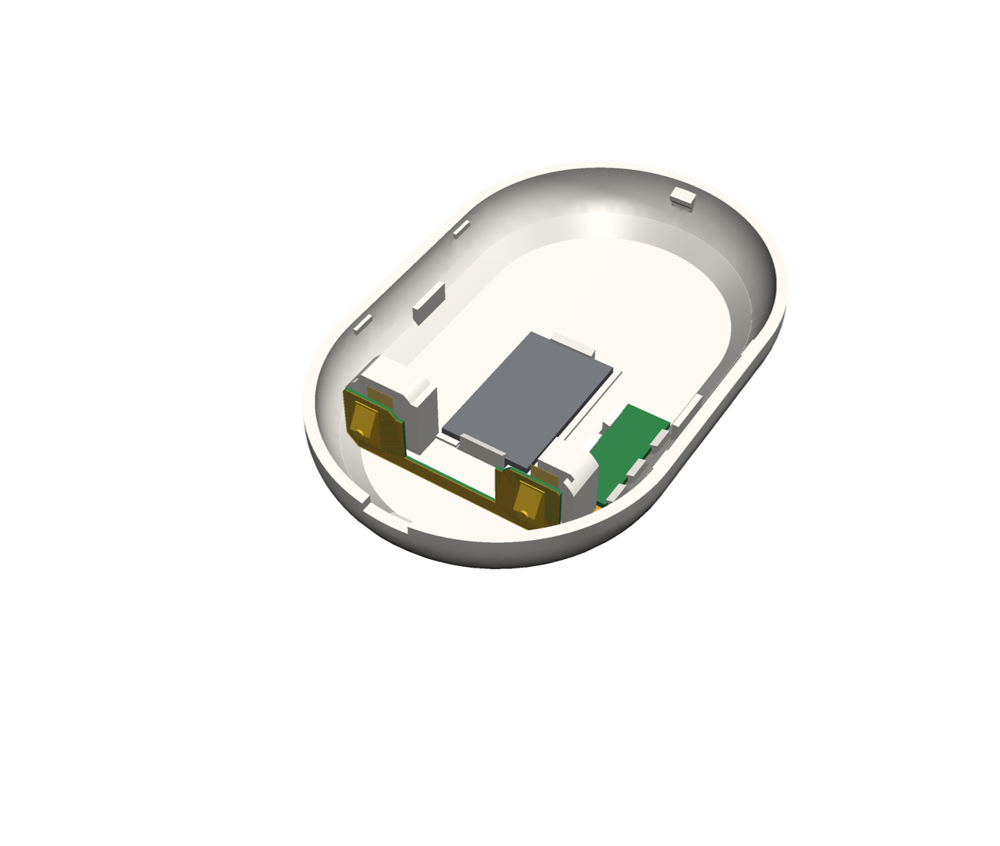
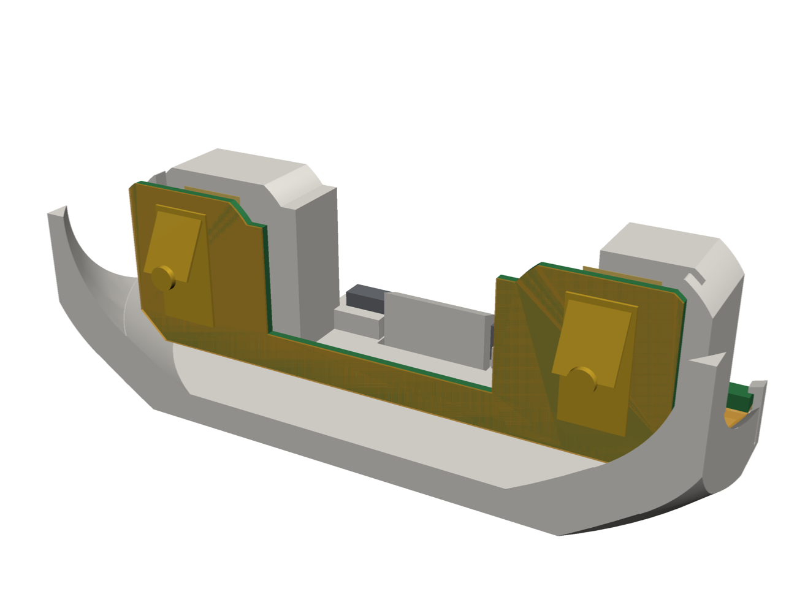
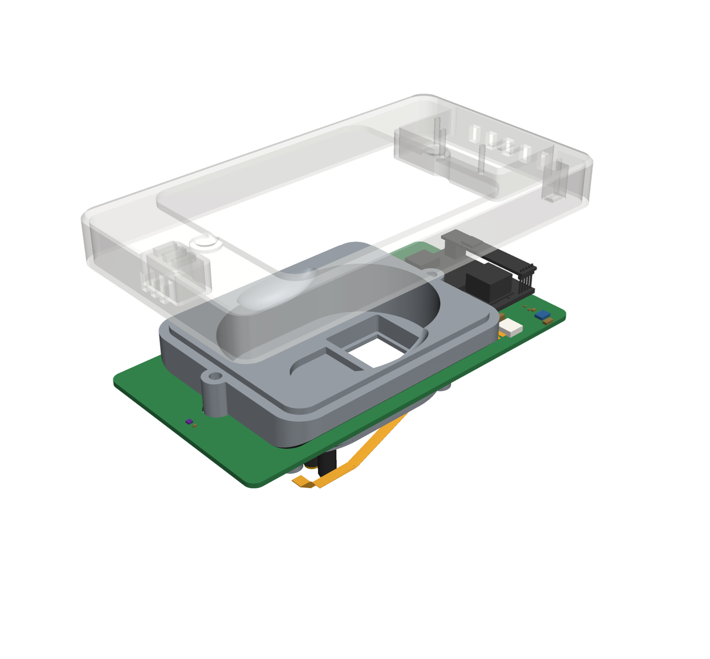
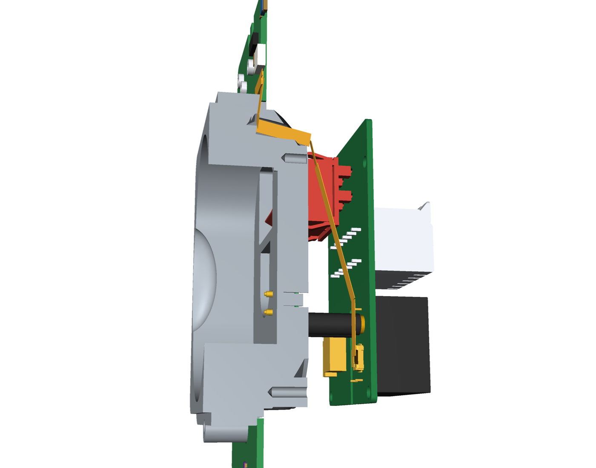
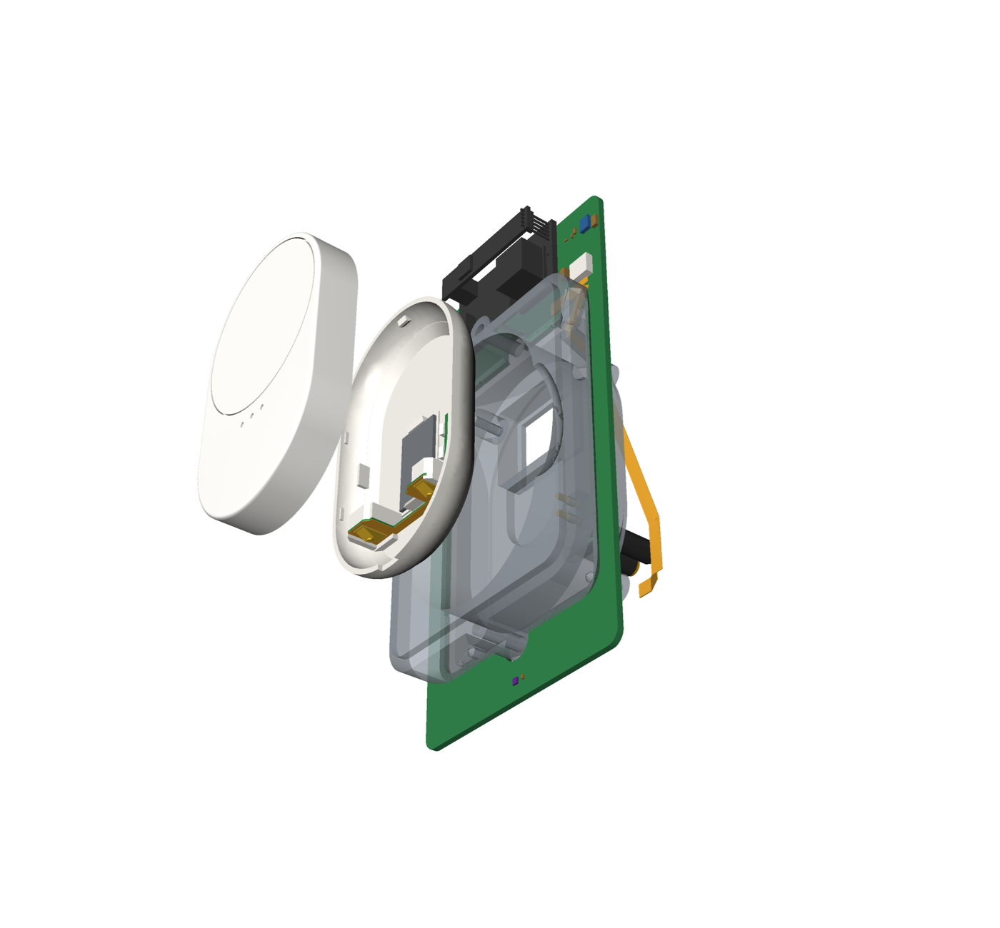
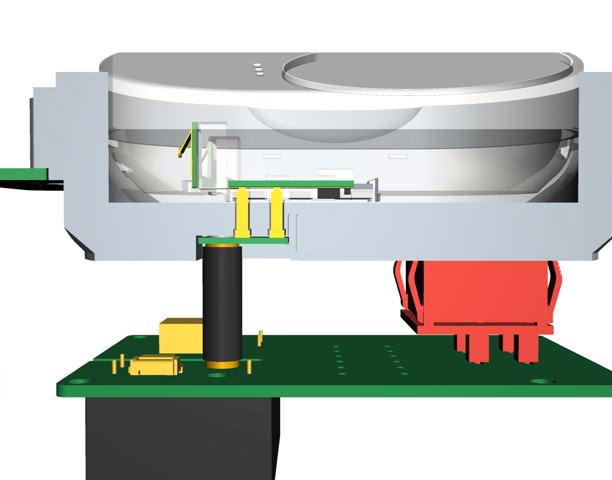
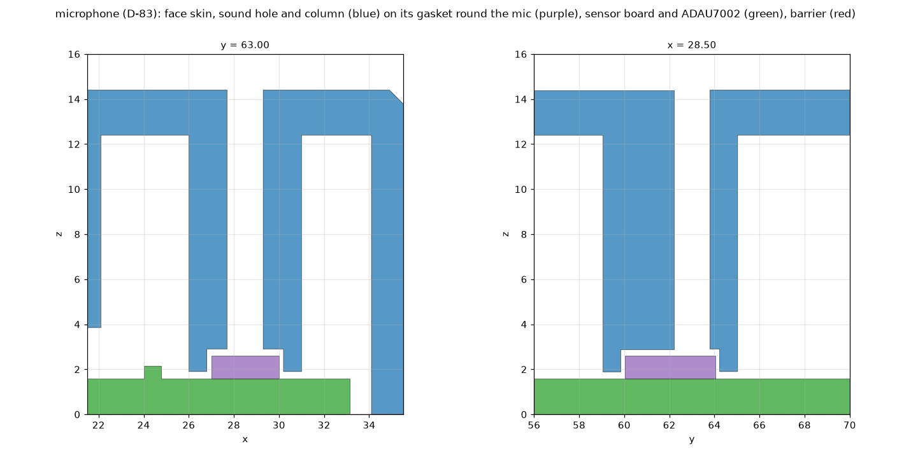
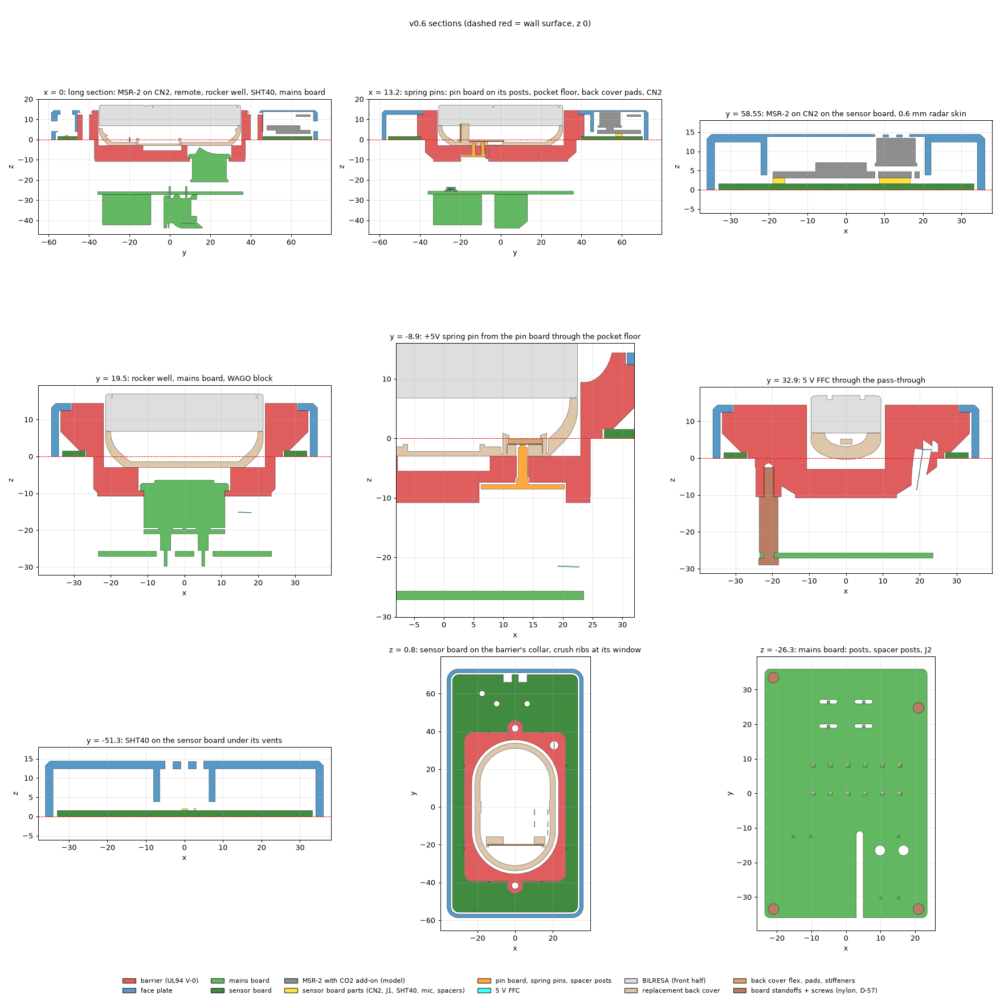

# Assembly: what holds each part

Every board, flex and electronic part is held by a screw, a solder joint, or a printed snap, hook or slot; no
tape. Nothing here is a compliance statement; mains work is a human decision (SAFETY).

> **Solder the rocker (S1) last, NA and EU.** Snap the rocker into its panel first, mount the board on its
> standoffs (NA) or bosses (EU) and tighten all its screws, and only then solder the rocker's pins or tabs from the
> board's back. The board's rocker holes are plated slots 5.2 mm long (D-88), so they do not locate the rocker: the
> panel cutout does. A rocker soldered before the board is fixed can end up off its cutout, stressing the snap
> latches and the joints, or not seating in the panel.

## NA plate

| Part | Held by | Notes |
| --- | --- | --- |
| Barrier | the two #6-32 box screws through its flange | |
| Face plate | clamped by the same screws; two pins key it | passive: no electronics, no contacts (D-50) |
| Mains board | four nylon M3 standoffs (Keystone 25503) screwed into the barrier's tapped bosses, a nylon M3 × 8 screw through each corner hole (D-57) | cut the top-right standoff's stud to 5 mm first |
| Rocker, WAGO, PSU, F1, RV1, J2, spacer posts P1 / P2 | soldered; the rocker also snaps into the barrier's panel | rocker soldered last, with the board screwed down (see the note at the top) |
| Spacer studs (WA-SBRIE) | screwed into P1 / P2; heatshrink over each post | D-50 |
| Pin board | two M2 × 5 screws into the studs; in its pocket under the pocket floor, two snap clips in the pocket (top edge, right edge) hold its back face against the pins' push | D-50, D-91 |
| Spring pins | soldered on the pin board; their barrels stand in the floor holes | D-50 |
| FFC, mains board end | FH12 slide latch on J2 | |
| FFC, run | from J2 between the rocker and the top-right standoff to the straight bore's mouth on the barrier's underside, through the bore and the slot; out of the flange onto the sensor board; the spare folded flat in four layers beside J1, between the flange and J1 | D-50, D-74 |
| FFC, sensor board end | FH12 slide latch on the sensor board's J1 | |
| Sensor board | pressed onto eight crush ribs on the collar's outside (0.15 mm into its window edge) for handling; in the box the flange's 1.8 mm land clamps its inner edge against the wall, the face plate's posts and frames the rest | D-50, D-68 |
| MSR-2 | CN2 on the sensor board and three 1.5 mm SMT spacers under its board; three posts on the face plate press its board onto the spacers (the skin stands 0.3 mm clear of the CO2 add-on and the radar) | D-50, D-66, D-68 |
| SHT40, passives, J1, SMT spacers H1–H3 | soldered on the sensor board | D-68 |
| Microphone, ADAU7002 | soldered on the sensor board (PCBWay assembly: the ADAU7002 is a 0.4 mm WLCSP); the face plate's sound column presses its gasket on the board round the mic | D-83 |
| Supplied steel plate (cut piece) | its own adhesive in the pocket-floor recess; cut with the hacksaw guide | D-43, D-52 |

## Order of work for the NA plate

0. Cut the supplied steel plate: lay it whole in the hacksaw guide, round end on the stop, clamp the guide in a vise
   and saw down the slot. Deburr the cut edge.
1. Mains board: solder P1 / P2 with the SMD parts (reflow); screw the WA-SBRIE studs in; heatshrink.
2. Sensor board: solder the hand parts (PCBWay fits the SMD parts); stick the mic gasket round the mic; plug the MSR-2
   onto CN2.
3. Barrier: snap the rocker into its panel from the front. Do not solder it yet.
4. Pin board: screw it onto the studs (M2 × 5); check that each pin moves freely.
5. Fit the mains board on its standoffs (the pins enter the floor holes from behind; the rocker's pins or tabs
   enter the board's slots; the pin board snaps past the two clips in its pocket) and tighten all four screws. To take
   the board off again, press the two clip hooks outwards with a pick while pulling it back.
6. **Now solder the rocker** from the board's back, with the board screwed down and the rocker seated in the panel.
   Then push the FFC's end into the straight bore from the underside (lay it in the groove in the corner taper, push
   it up round the one bend into the slot); it comes out under the flange; latch it into J2 from the side
   (J2 faces the board's right edge).
7. Sensor board: slide it over the plug from behind (the window passes the mains board) and press it onto the collar's
   ribs until it sits under the flange's land. From the face side pull the cable up until it lies taut along its
   route, fold the spare in four flat layers left of J1 and latch it into J1.
8. In the box: wire the WAGO block, screw the barrier to the ears, put the face plate on.

## EU plate

| Part | Held by | Notes |
| --- | --- | --- |
| Barrier | two screws into the box's top and bottom domes | |
| Face plate | four snap fingers at the corners drop into closed, keyed windows in the sensor board and the carrier (the wide one top right) and catch the grooves in the carrier's windows | D-70, D-77 |
| Mains board, pin board | M2 screws on the barrier's long bosses | |
| Rocker, WAGO blocks, PSU, header, socket, spring pins | soldered; the rocker also snaps into the cup | rocker soldered last, with the mains board screwed onto the barrier's bosses (see the note at the top) |
| Cut steel piece | adhesive, in the recess in the barrier's pocket floor (round end down), 0.5 mm below the seat | D-72 |
| Carrier | on the wall before the barrier; its lip under the barrier's edge, pinned to the wall by the barrier's two screws; the barrier's four teeth in gaps in the lip stop it turning (keyed, one way only) | D-56, D-71 |
| Sensor board | in the carrier's rim, four M2 × 6 screws into the carrier; the pin board's sensor pins press up on its pads | D-56, D-70 |
| MSR-2 board | CN2 on the sensor board and three 1.5 mm SMT spacers under its board; three posts on the face plate press its board onto the spacers (the skin stands 1.3 mm clear of its front) | D-67, D-70 |
| Microphone, ADAU7002 | soldered on the sensor board (PCBWay assembly); the face plate's sound column on its gasket round the mic | D-83 |
| SHT40 | soldered on the sensor board under its vents | D-56 |

## Order of work for the EU mains board

1. Snap the rocker into the barrier's cup from the front. Do not solder it yet.
2. Screw the pin board onto its bosses just under the barrier.
3. Put the mains board (WAGO blocks, PSU, F1, RV1 and the header already soldered) onto the barrier's long bosses from
   behind, its header into the pin board's socket and the rocker's pins or tabs through its slots, and tighten the
   M2 screws (D-36, D-59).
4. **Now solder the rocker** from the mains board's back, with the board screwed down and the rocker seated in the
   cup.
5. In the box (breaker off): join the protective earth from the supply and to the lights in the WAGO 221-412
   lever connector (D-94); the boards carry no PE. Keep whatever PE the box has continuous; a third PE conductor
   (a looped feed) takes a 221-413. Then L and N into the two 2604-3102 blocks on the mains board's back.

## Plain plates (D-109)

As the full plates, without the sensors' parts:

- NA: no sensor board and no FFC; the plain barrier has no cable bore. The plain face plate (69.85 × 114.3 mm) is clamped
  by the same two screws and keyed by the same two pins. The pin board, its spacer posts and the spring pins as the full plate.
- EU: no sensor board and no sensor pins (P1 / P2 left off the pin board); the plain barrier has only the battery-free pins'
  holes. The plain carrier's lip goes under the barrier's edge as before; the plain face plate (80 × 80 mm) snaps into the
  carrier's four corner windows.

## Replacement back cover

| Part | Held by | Notes |
| --- | --- | --- |
| Cover on the remote | two snap clips (top, bottom) on the housing's wall; side ribs keep it from flexing; four small tabs inside the cover's long side walls sit in slots in the housing (D-90) | pry it off at the notch |
| Plate (magnet, 12 × 20 × 2) | a ridge round it on the full-thickness shell, a clip at each end | snap in from above; print the cover in PETG (the clips broke in PLA) |
| Cover flex, pad and regulator sections | 0.8 mm FR4 stiffener on top, pressed down past five snap hooks on its long edges (each side of each pin pad and of the regulator, none on the inner edge beside the GND pad, D-79) | press straight down until all five click; to remove, spread the hooks on one edge with a pick |
| Cover flex, run | lies on the ledge, in a notch along the GND contact post's inner face (D-79) | drops in from above |
| Cover flex, end section | slides down a slot along each contact block's outer face (lip over its outer edge) into the slot behind the foot lips (D-55) | slide the end section in from above first, then lay the strip on the ledge and press the pad section down past its hooks |

## Order of work for the back cover

1. Snap the plate into its pocket.
2. Slide the end section (bent up, fingers facing the battery contacts) straight down the slots along the two contact
   blocks' outer faces until its foot sits in the slot behind the foot lips.
3. Lay the run on the ledge, in the notch along the GND contact post's inner face.
4. Press the pad and regulator sections straight down onto the ledge, the pin pads over their windows and
   the regulator into its recess, until the five snap hooks click over the stiffener.
5. Check that no hook is left standing on the stiffener's top.
6. Snap the cover onto the remote (both clips), notch at the bottom end.

## Back cover flex, rendered

The back cover with its flex drawn 2.5 mm off it, so both show (`cad/build123d/render_shared.py`).

NA and EU plates: no flex (D-50, D-56).

Replacement back cover: snap hooks hold the pad and regulator sections, the end section slides down a slot
along each contact block (D-55), the run lies in the notch along the GND contact post (D-79).

| Cover | End section |
| --- | --- |
|  |  |

## Detail views

NA plate: the face plate lifted off (it carries no electronics), the 5 V path (FFC from the mains board through the
barrier's bore to the sensor board), the spring pins of the battery-free remote, the microphone's sound column, and a
section of every printed part (dashed line: the wall surface).

| Face plate off | 5 V path |
| --- | --- |
|  |  |

| Battery-free remote | Spring pins, section |
| --- | --- |
|  |  |

| Sensor board (red: copper keep-out round the box opening) | Microphone sections |
| --- | --- |
|  |  |

EU plate: the sensors' side (carrier, sensor board, MSR-2, microphone, SHT40), the carrier clamp from the wall side and
its lip in section, the sensor pins onto the sensor board's pads, a face plate snap, a section and the box from behind.

| Sensors | Box from behind |
| --- | --- |
|  |  |

| Carrier clamp | Carrier lip |
| --- | --- |
|  |  |

| Sensor pins | Face plate snap |
| --- | --- |
|  |  |

Back cover: its back with the two pin windows, a section through a pin pad and one through the VBAT contact.

| Back | Pin pad, section |
| --- | --- |
|  |  |

Steel plate hacksaw guide (red: the cut line).

