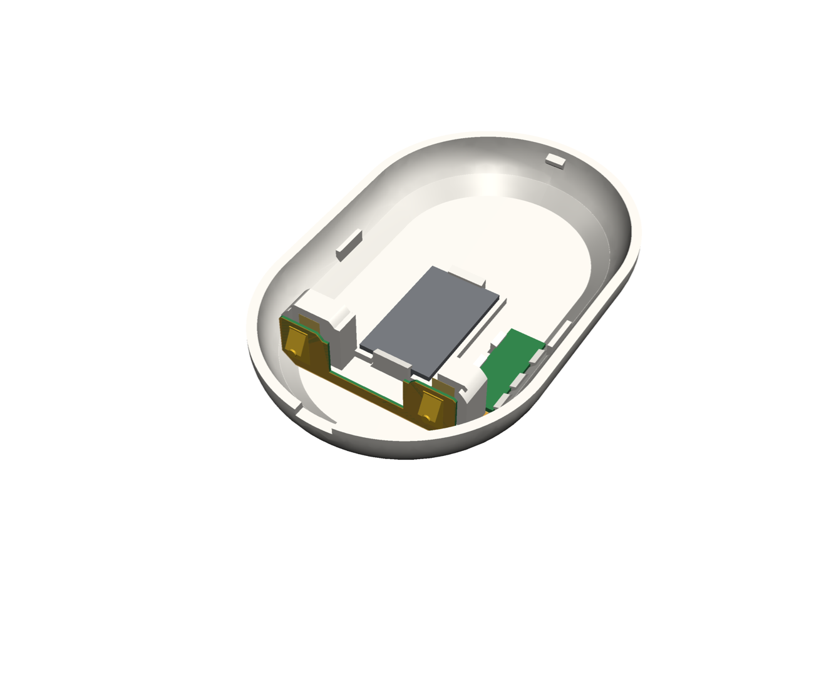
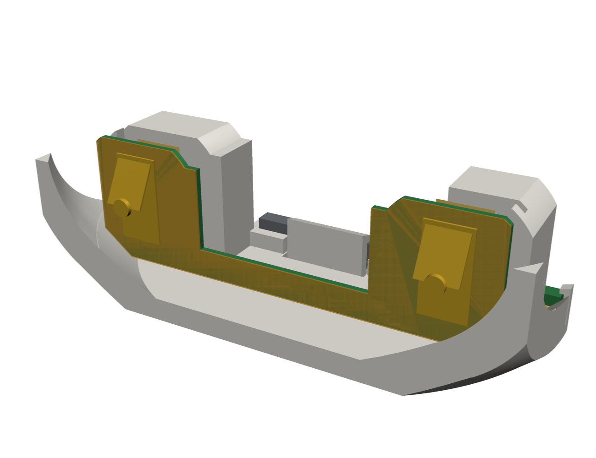

# Assembly: what holds each part

Every board, flex and electronic part is held by a screw, a solder joint, a printed snap or hook, or a
named tape point. Tape is **3M 467MP** (0.06 mm, double-sided), cut to the pad
sizes below. Nothing here is a compliance statement; mains work is a human decision (SAFETY).

## NA plate

| Part | Held by | Notes |
| --- | --- | --- |
| Insert | the two #6-32 box screws through its flange | |
| Trim (face plate) | clamped by the same screws; two pins key it | passive: no electronics, no contacts (D-50) |
| Wiring board | four nylon M3 standoffs (Keystone 25503) screwed into the insert's tapped bosses, a nylon M3 × 8 screw through each corner hole (D-57) | cut the top-right standoff's stud to 5 mm first |
| Rocker, WAGO, PSU, F1, RV1, J2, spacer posts P1 / P2 | soldered; the rocker also snaps into the insert's panel | |
| Spacer studs (WA-SBRIE) | screwed into P1 / P2; heatshrink over each post | D-50 |
| Riser board | two M2 × 5 screws into the studs; in its pocket under the pocket floor | D-50 |
| Spring pins | soldered on the riser; their barrels stand in the floor holes | D-50 |
| FFC, wiring board end | FH12 slide latch on J2 | |
| FFC, run | from J2 between the rocker and the top-right standoff to the straight bore's mouth on the insert's underside, through the bore and the slot; out of the flange onto the ring board; the spare folded flat in four layers beside J1, between the flange and J1 | D-50, D-74 |
| FFC, ring board end | FH12 slide latch on the ring board's J1 | |
| Ring board | pressed onto eight crush ribs on the collar's outside (0.15 mm into its window edge) for handling; in the box the flange's 1.8 mm land clamps its inner edge against the wall, the face plate's posts and frames the rest | D-50, D-68 |
| MSR-2 | CN2 on the ring board and three 1.5 mm SMT spacers under its board; three posts on the face plate press its board onto the spacers (the skin stands 0.3 mm clear of the CO2 add-on and the radar) | D-50, D-66, D-68 |
| SHT45, passives, J1, nuts | soldered on the ring board | |
| Mic carrier | soldered flat on the ring board by its castellated edges; the face plate's sound tube presses its gasket on | D-50 |
| Supplied steel plate (cut piece) | its own adhesive in the pocket-floor recess; cut with the hacksaw guide or the marker gauge | D-43, D-52 |

## Order of work for the NA plate

0. Cut the supplied steel plate: lay it whole in a jig, round end on the stop. Hacksaw guide: clamp the jig in a vise
   and saw down the slot. Marker gauge: mark along the fence, then cut with metal shears, a grinder or a hacksaw.
   Deburr the cut edge.
1. Wiring board: solder P1 / P2 with the SMD parts (reflow); screw the WA-SBRIE studs in; heatshrink.
2. Ring board: solder the parts and the mic carrier; plug the MSR-2 onto CN2.
3. Insert: fit the rocker.
4. Riser: screw it onto the studs (M2 × 5); check that each pin moves freely.
5. Fit the wiring board on its standoffs (the pins enter the floor holes from behind). Push the FFC's end into the
   straight bore from the underside (lay it in the groove in the corner taper, push it up round the one bend into the
   slot); it comes out under the flange; latch it into J2 from the side
   (J2 faces the board's right edge).
6. Ring board: slide it over the plug from behind (the window passes the wiring board) and press it onto the collar's
   ribs until it sits under the flange's land. From the face side pull the cable up until it lies taut along its
   route, fold the spare in four flat layers left of J1 and latch it into J1.
7. In the box: wire the WAGO block, screw the insert to the ears, put the face plate on.

## EU plate

| Part | Held by | Notes |
| --- | --- | --- |
| Cap | two screws into the box's top and bottom domes | |
| Trim | four snap fingers at the corners drop into closed, keyed windows in the cap board and the carrier (the wide one top right) and catch the grooves in the carrier's windows | D-70, D-77 |
| Mains board, 5 V board | M2 screws on the cap's long bosses | |
| Rocker, WAGO blocks, PSU, header, socket, spring pins | soldered; the rocker also snaps into the cup | |
| Cut steel piece | adhesive, in the recess in the cap's pocket floor (round end down), 0.5 mm below the seat | D-72 |
| Carrier | on the wall before the cap; its lip under the cap's edge, pinned to the wall by the cap's two screws; the cap's four teeth in gaps in the lip stop it turning (keyed, one way only) | D-56, D-71 |
| Cap board | in the carrier's rim, four M2 × 6 screws into the carrier; the 5 V board's sensor pins press up on its pads | D-56, D-70 |
| MSR-2 board | CN2 on the cap board and three 1.5 mm SMT spacers under its board; three posts on the face plate press its board onto the spacers (the skin stands 1.3 mm clear of its front) | D-67, D-70 |
| Mic carrier | soldered flat on the cap board's land over its window; the face plate's sound tube on its gasket | D-70 |
| SHT45 | soldered on the cap board under its vents | D-56 |

## Replacement back cover

| Part | Held by | Notes |
| --- | --- | --- |
| Cover on the remote | two snap clips (top, bottom) on the housing's wall; side ribs keep it from flexing | pry it off at the notch |
| Plate (magnet, 12 × 20 × 2) | a ridge round it on the full-thickness shell, a clip at each end | snap in from above; print the cover in PETG (the clips broke in PLA) |
| Cover flex, pad and regulator sections | 0.8 mm FR4 stiffener on top, pressed down past six snap hooks on its long edges (each side of each pin pad and of the regulator) | press straight down until all six click; to remove, spread the hooks on one edge with a pick |
| Cover flex, run | the slot under the GND contact block | |
| Cover flex, end section | slides down a slot along each contact block's outer face (lip over its outer edge) into the slot behind the foot lips (D-55) | slide the end section in from above first, then lay the strip on the ledge and press the pad section down past its hooks |

## Order of work for the back cover

1. Snap the plate into its pocket.
2. Thread the flex's run through the slot under the GND block from the cell side; press the pad and
   regulator sections straight down onto the ledge, the pin pads over their windows and the regulator
   into its recess, until the six snap hooks click over the stiffener.
3. Check that no hook is left standing on the stiffener's top.
4. Fold the end section up (foot into the lip slots) and press it onto the blocks until both side hooks
   click over its outer edges.
5. Snap the cover onto the remote (both clips), notch at the bottom end.

## Tape points, rendered

The back cover with its flex drawn 2.5 mm off it, so both show (`cad/build123d/render_tape.py`).

NA plate: no flex and no tape (D-50).

Replacement back cover: no tape; snap hooks hold the pad and regulator sections, the end section slides
down a slot along each contact block (D-55).

| Cover | End section |
| --- | --- |
|  |  |
