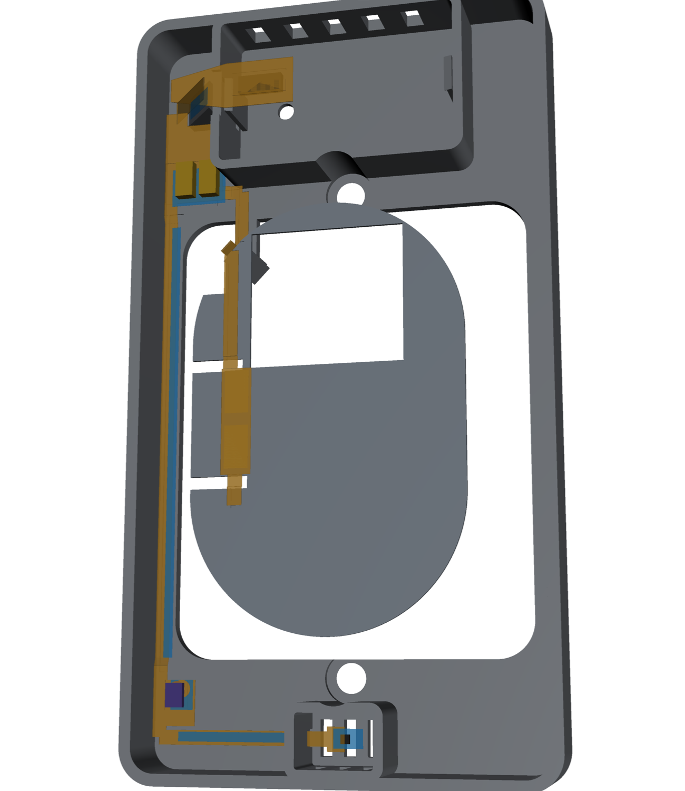
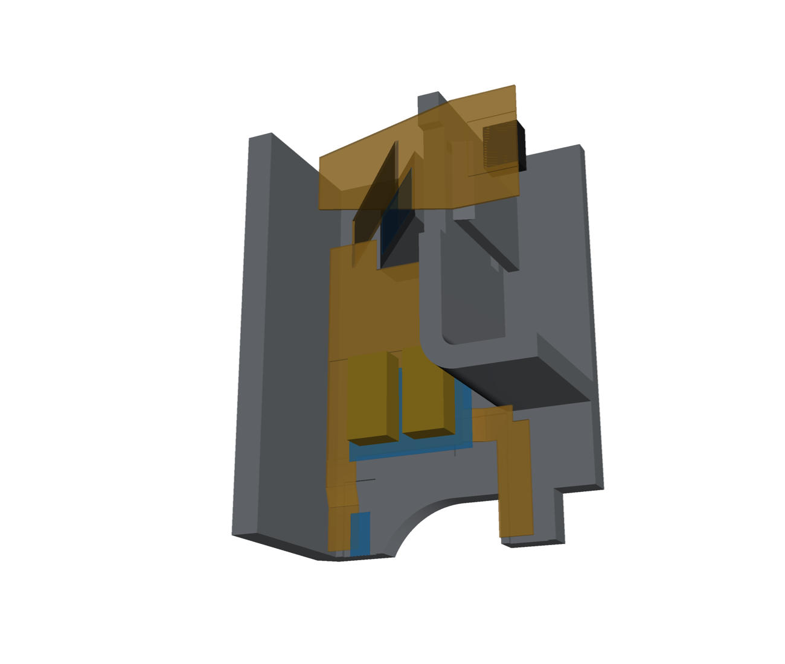
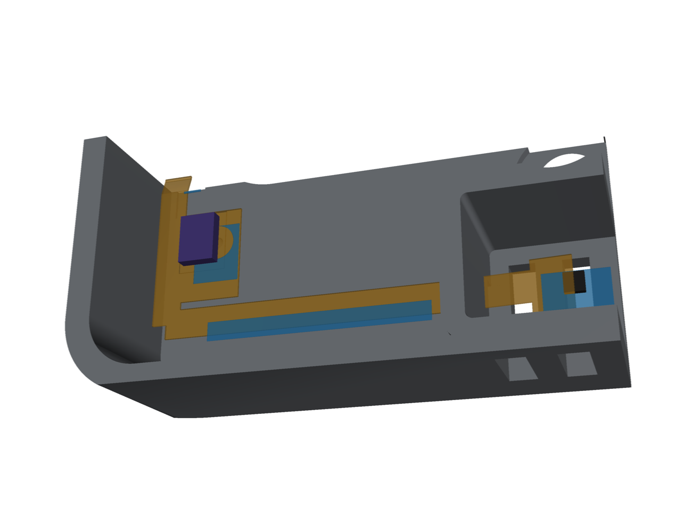
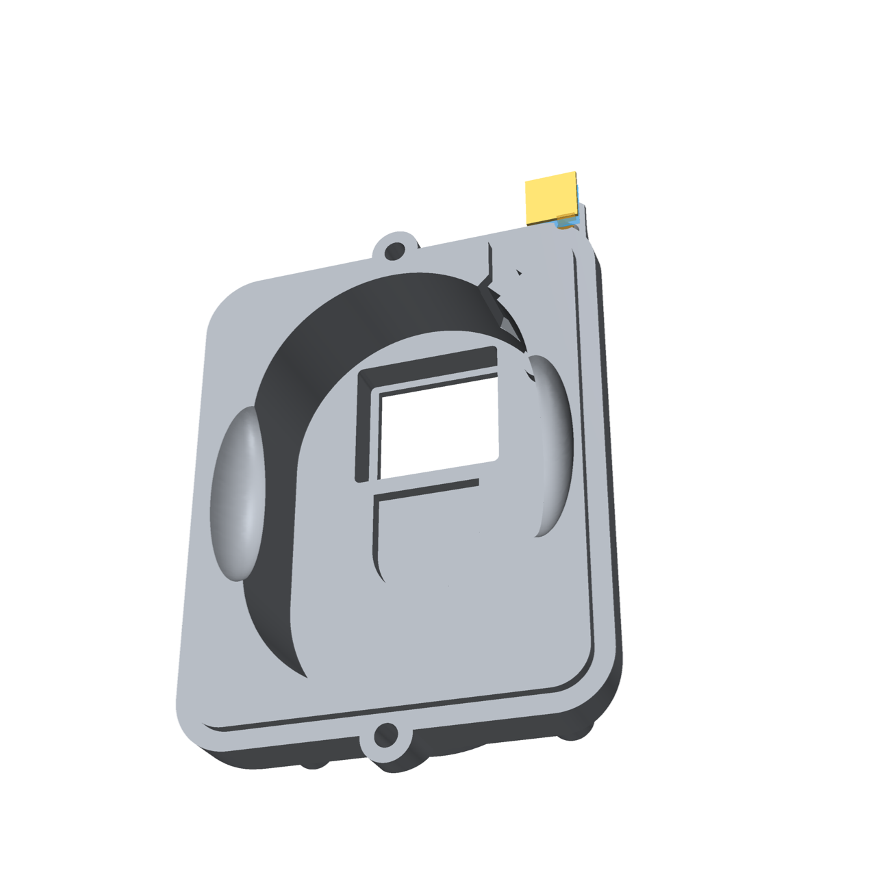
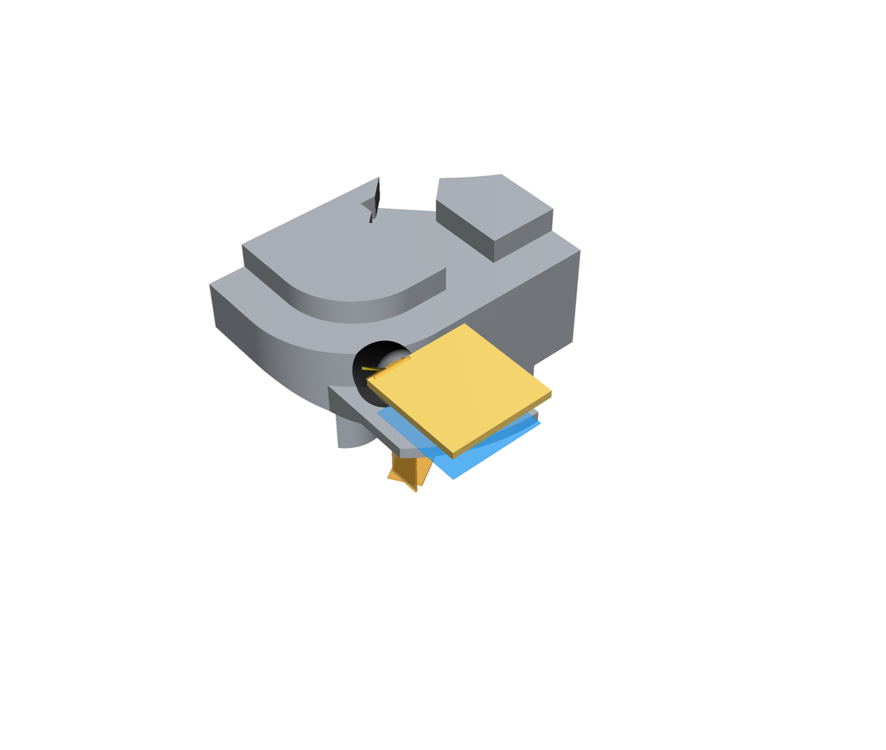
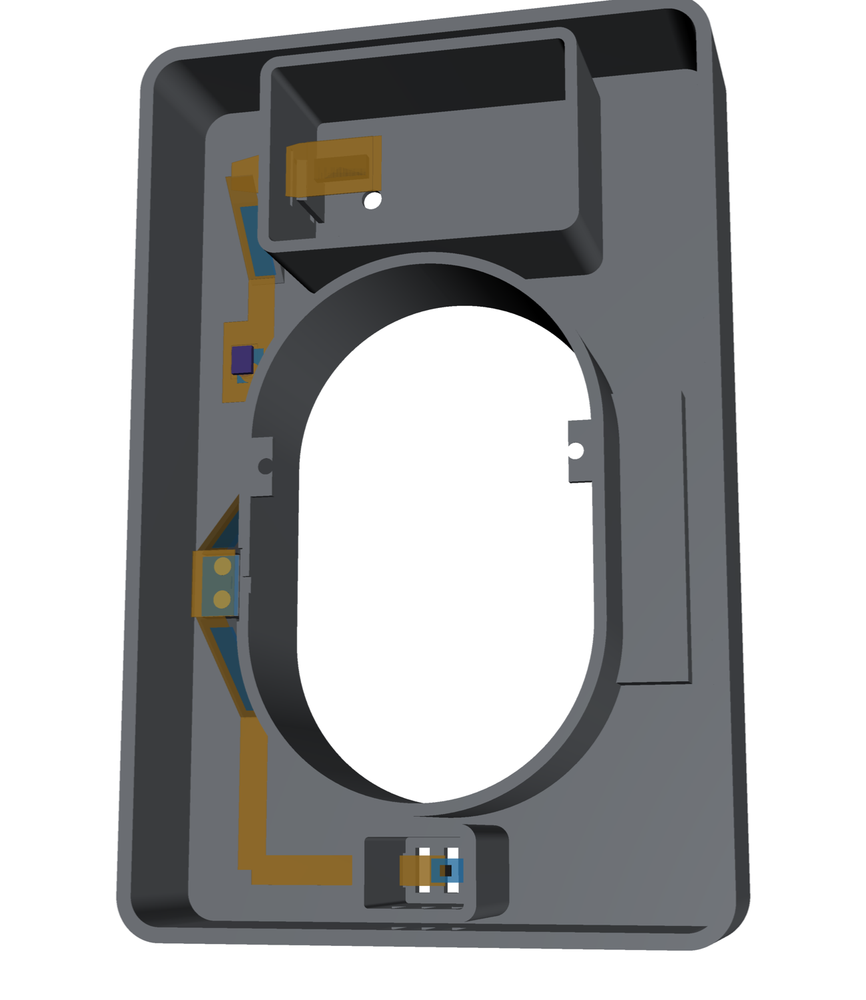
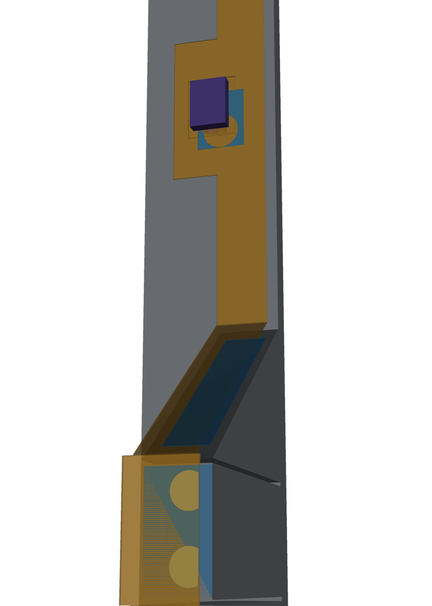
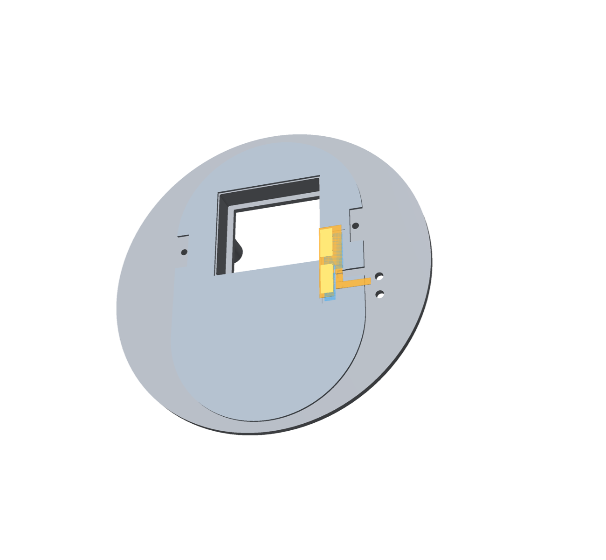

# Assembly: what holds each part

Every board, flex and electronic part is held by a screw, a solder joint, a printed snap or hook, or a
named tape point. Tape is **3M 467MP** (0.06 mm, double-sided), cut to the pad
sizes below. Nothing here is a compliance statement; mains work is a human decision (SAFETY).

## NA plate

| Part | Held by | Notes |
| --- | --- | --- |
| Insert | the two #6-32 box screws through its flange | |
| Trim | clamped by the same screws; two pins key it | |
| Wiring board | four screw-in snap posts (D-28) | |
| Rocker, WAGO, PSU, F1, RV1, J2 | soldered; the rocker also snaps into the insert's panel | |
| 5 V jumper, connector end | FH12 slide latch on J2 | |
| 5 V jumper, run | the service loop folds loose between board and insert (it has to, to plug in with the board beside the insert); guided through the pass-through | D-31 |
| 5 V jumper, pad end | tape on its stiffener to the corner shelf; the flange's face below it stops it sliding down; the spring fingers press it down | D-47 |
| Sensor-flex tongue (battery-free) | the trim's underside groove over the flange (the flange clamps it) and the groove under the trim's tab in the island notch; behind the trim's strip down the pocket's arc (the insert's groove takes strip and tongue); under the floor insert in its channel, up its slot onto the pad strip, the tail down the second slot (both laid in sideways through the notches) | no tape; part of the face plate (D-49) |
| NA floor insert | hangs from the trim strip's foot (its hook in the window of the floor's tab); lies on the pocket floor, the remote on it | comes off with the face plate; fitted for a battery remote too (D-49) |
| MSR-2 board | two snap hooks at its short ends in the trim's bay (D-45), plus CN2 | snap in from behind |
| Sensor flex | CN2 plug; tape (each point checked for room in `make check`): the rise from CN2 along the underside of the trim's ramp; the finger-section stiffener to the face skin; the band run into the trim's groove (the flange clamps it once the trim is on); the microphone stiffener to the skin (the mic's own gasket ring seals its port); the bottom run between the fold and the SHT45 bay to the skin; the SHT45 tail's back to the floor of its bay | D-47, D-48 |
| Supplied magnet (cut piece) | its own adhesive in the pocket-floor recess | D-43 |

## EU plate

| Part | Held by | Notes |
| --- | --- | --- |
| Cap | two screws into the box's top and bottom domes | |
| Trim | two M2 screws through its tabs into the cap | |
| Mains board, 5 V board | M2 screws on the cap's long bosses | |
| Rocker, WAGO blocks, PSU, header, socket, spring pins | soldered; the rocker also snaps into the cup | |
| Floor insert | glued to the trim (lifts off with it) | |
| Tongue | enters under the pocket wall's notch, runs under the floor insert, folds there, its neck rises through the slot onto the top (laid in sideways through the notch); the pads lie in the top recess | no tape (D-49) |
| MSR-2 board | two snap hooks at its short ends in the trim's bay (D-45), plus CN2 | |
| Sensor flex | CN2 plug; tape: the rise from CN2 and both slopes of the dip to the pin pads along the undersides of the trim's ramps, the pad section's stiffener to its rib in the trim (the spring pins press it up against it), the microphone stiffener to the skin, the SHT45 tail to its bay | D-48 |
| Cut magnet piece | glued under the cap floor | |

## Replacement back cover

| Part | Held by | Notes |
| --- | --- | --- |
| Cover on the remote | two snap clips (top, bottom) on the housing's wall; side ribs keep it from flexing | pry it off at the notch |
| Plate (magnet, 12 × 20 × 2) | a ridge round it on the full-thickness shell, a clip at each end | snap in from above; print the cover in PETG (the clips broke in PLA) |
| Cover flex, pad and regulator sections | 0.8 mm FR4 stiffener on top, pressed down past six snap hooks on its long edges (each side of each finger and of the regulator) | press straight down until all six click; to remove, spread the hooks on one edge with a pick |
| Cover flex, run | the slot under the GND contact block | |
| Cover flex, end section | its foot drops into the slot behind a lip on each contact block; a snap hook beside each block's outer side catches its outer edge (PETG; lips 0.35 mm over the copper face, below the rim) | fold it up onto the blocks until both hooks click |

## Order of work for the back cover

1. Snap the plate into its pocket.
2. Thread the flex's run through the slot under the GND block from the cell side; press the pad and
   regulator sections straight down onto the ledge, the fingers into their windows and the regulator
   into its recess, until the six snap hooks click over the stiffener.
3. Check that no hook is left standing on the stiffener's top.
4. Fold the end section up (foot into the lip slots) and press it onto the blocks until both side hooks
   click over its outer edges.
5. Snap the cover onto the remote (both clips), notch at the bottom end.

## Tape points, rendered

Each part with its flexes and the tape (3M 467MP, blue, semi-translucent). The flexes are drawn 2.5 mm off
the part they are taped to, so the part, the tape and the flex all show (`cad/build123d/render_tape.py`,
tape geometry in `tape.py` and `eu/tape_eu.py`).

NA face plate (trim, seen from the wall side): the sensor flex, taped under the ramp over its rise, the
finger section and the microphone to the skin, the band run in its groove, the bottom run and the SHT45 tail;
the battery-free tongue in its groove, behind the strip and under the floor insert hanging from the strip (D-49).

| Whole trim | Top-right corner | Bottom |
| --- | --- | --- |
|  |  |  |

NA insert (seen from the room) with the face plate off: only the 5 V jumper's pad end on the corner shelf
(D-49). The battery-free tongue and the floor insert are on the face plate side (NA trim render).

| Insert | Corner shelf |
| --- | --- |
|  |  |

Replacement back cover: no tape; snap hooks hold the pad and regulator sections and the end section (a
hook beside each contact block).

| Cover | End section |
| --- | --- |
|  |  |

EU face plate (trim, from the wall side) and floor insert: the flex taped under the ramps over its three
slopes, the pad section on its rib, the microphone, the SHT45 tail; the tongue in the floor insert's recess.

| EU trim | EU right channel | EU floor insert |
| --- | --- | --- |
|  |  |  |
