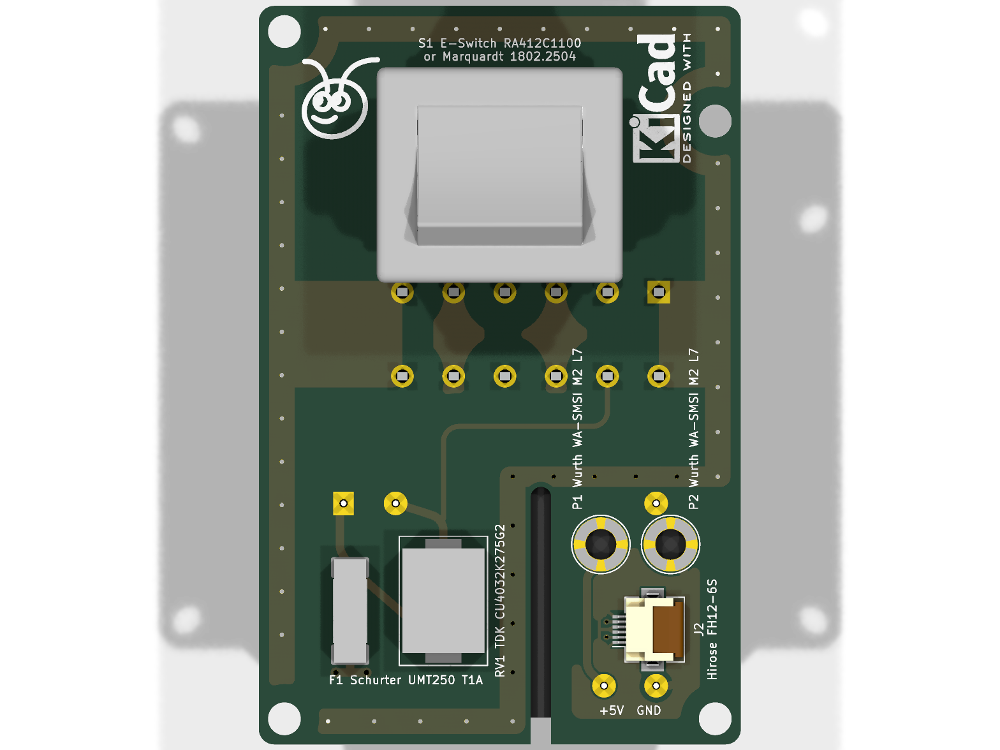

# Boards (v0.6)

Seven boards, generated from Python into KiCad 9 projects (ERC and DRC at all severities, schematic parity), in one
folder per variant and one for the board both variants share. Spacing values are design targets for human review.
Nothing here is a compliance claim, and nothing has been checked by a third party.

| Folder | Boards | Details |
| --- | --- | --- |
| `na/` | NA mains board, sensor board, pin board | [`na/README.md`](na/README.md) |
| `eu/` | EU mains board, pin board, sensor board | [`eu/README.md`](eu/README.md) |
| `shared/` | back cover flex; the low-voltage board generator for both variants | [`shared/README.md`](shared/README.md) |
| `tools/` | helpers every generator uses (`kigen.py`, `fplib.py`, `common_parts.py`, `gen_3d.py`), renders, order lists | - |
| `order/` | DigiKey / Mouser order lists and PCBWay packs | [`order/README.md`](order/README.md) |

| Board | Editions | Size, material | Carries | Status |
| --- | --- | --- | --- | --- |
| NA mains board | all | 47 × 72 mm, FR4 1.6 mm (high-CTI; copper weight open: 1 oz designed, 2 oz option), 2 layers | rocker switch S1, WAGO 2604-1106 (L / N / PE in and out), F1, RV1, Mean Well IRM-03-5, J2 (5 V FFC), spacer posts P1 / P2; switch only: S1 and J1 alone | PCBWay pack in `na/fab/na_mains_board/` |
| NA sensor board | full | 66.3 × 125.9 mm, FR4 1.6 mm, 2 layers | J1 (5 V FFC), J2 (MSR-2's CN2), SHT40, microphone + ADAU7002 | no fab files: CN2 pinout not confirmed |
| NA pin board | battery-free, full | 14 × 12 mm, FR4 0.8 mm, 2 layers | two Harwin P70 spring pins onto the back cover, on the mains board's spacer posts | PCBWay pack in `na/fab/na_pin_board/` |
| EU mains board | all | Ø58 mm, FR4 1.6 mm (high-CTI, 2 oz), 2 layers | rocker switch S1, two WAGO 2604-3102, F1, RV1, Zettler ZPI03S0500WC, J3 (5 V header); switch only: S1, J1, J2 alone | PCBWay pack in `eu/fab/eu_mains_board/` |
| EU pin board | battery-free, full | 58 × 27.9 mm D-shape, FR4 1.6 mm, 2 layers | socket on the mains board's J3, C1, four Harwin P70 spring pins (sensor board, back cover) | PCBWay pack in `eu/fab/eu_pin_board/` |
| EU sensor board | full | 76 × 113.8 mm, FR4 1.6 mm, 2 layers | pads for the pin board's spring pins, J2 (MSR-2's CN2), SHT40, microphone + ADAU7002 | no fab files: CN2 pinout not confirmed |
| Back cover flex | battery-free, full (both variants) | 31.2 × 30.1 mm flat, polyimide 0.10 mm, 1 copper layer, FR4 stiffeners | pads for the spring pins, ESD diode, 3.3 V regulator, two spring fingers onto the remote's cell contacts | no fab files: contact positions not measured on a remote |

| NA mains board | NA sensor board | NA pin board |
| --- | --- | --- |
|  |  |  |

| EU mains board | EU pin board | EU sensor board |
| --- | --- | --- |
|  |  |  |

| Back cover flex |
| --- |
|  |

## Silkscreen labels and 3D models (all boards)

Every part carries a silkscreen label with its reference and maker / model (value and size for
generic passives; net names on bare contact pads), on the side it is mounted, placed by
`tools/kigen.py` (`place_labels`): next to the part, clear of pads, other silkscreen, other parts'
courtyards and the board outline (slots included). On a single-layer flex with no room on the
copper side the label goes on the bare back. ERC / DRC (all severities) check the result.

3D models come from `tools/gen_3d.py` into each project's `kicad/3d/`: a vendor STEP from
`scratch/3d/` when present (moved into footprint coordinates by its entry), otherwise an envelope
from the datasheet dimensions. Vendor files stay in the git-ignored `scratch/` (their terms).

| Model | Source now | Vendor model |
| --- | --- | --- |
| Traco TMPS 03 | vendor (tracopower.com, 3D drawings; pins checked against the pads) | in use |
| Mean Well IRM-03, Hirose FH12-6S, Samtec TSM (EU J3), 0402 / 1206 passives | KiCad library | in use |
| Schurter UMT 250 | envelope | <https://www.schurter.com/en/datasheet/UMT%20250> |
| TDK SIOV CU4032K275G2 (B72660M0271K093) | envelope | <https://product.tdk.com/en/search/sensor/protect/varistor/info?part_no=B72660M0271K093> |
| WAGO 2604-3102 | vendor (wago.com, CADENAS; pins checked against the pads) | in use |
| WAGO 2604-1106 | vendor (wago.com, CADENAS; pins checked against the pads) | in use |
| Marquardt 1802.2504 | vendor 1802.1108 housing (Marquardt LIB_1802.1108; same 1802 flange, rocker, body) on the 1802.2504 underside from its drawing (body to 11.7, pin stems to the 16.2 seat, 0.8 pins; pins checked against the pads) | 1802.2504 itself: on request from Marquardt |
| Harwin P70-2200045 | envelope | <https://www.harwin.com/products/P70-2200045/> |
| Harwin S7081-42R | envelope (shape from the drawing) | <https://www.harwin.com/products/S7081-42R/> |
| Knowles SPK0641HT4H-1 | envelope (top port marked) | <https://www.knowles.com/docs/default-source/model-downloads/spk0641ht4h-1-rev-a.pdf> |
| Analog Devices ADAU7002 (WLCSP-8) | envelope | <https://www.analog.com/en/products/adau7002.html> |
| Sensirion SHT40 (DFN-4) | envelope | <https://sensirion.com/products/catalog/SHT40> |

To use a vendor model: put its STEP in `scratch/3d/`, add the file name and its transform to the
entry in `tools/gen_3d.py`, run `make pcb`, and check the pins against the pads (export the board
to STEP).

## Regenerate

Needs KiCad 9 (`kicad-cli` and the `pcbnew` Python module) and the repository's `.venv` with build123d.

```bash
make pcb        # na/tools/build.sh, eu/tools/build.sh, shared/tools/build.sh
```

Each `build.sh` writes the 3D models (`tools/gen_3d.py`), the libraries, projects and rules, schematics and boards of
its folder, runs ERC and DRC (reports in `build/`) and writes the fab packs that are not blocked. Footprints and symbols
shared by every board come from `tools/fplib.py`; each project folder's lib tables list its own library and the
low-voltage library (`lv`).
