# EU boards (v0.7)

The European plate's boards (round flush box, DIN 49073, Ø60 inside): the mains board and the pin board, both
hanging from bosses under the barrier, from `tools/gen_eu.py` with their parts in `tools/parts_eu.py` (D-30, D-36); the
sensor board in the carrier from `../shared/tools/gen_lv.py eu`, its parts in `tools/lv_parts_eu.py` (D-56, D-70).
Geometry from `cad/build123d/params.py` and `cad/build123d/eu/params_eu.py`. The back cover's flex, the same for both
variants, is in `../shared/README.md`.

Spacing values are design targets for human review. Nothing here is a compliance claim.

## Mains board (`kicad/eu_mains_board.*`, fab pack in `fab/eu_mains_board/`)

Round, at the rocker's PCB seat (16.2 mm below its panel face). The rocker breaks line and neutral
of the lights; the PSU is fed from the switched side, so the rocker also turns the sensor off.

| Ref | Part | Side | Nets |
| --- | --- | --- | --- |
| S1 | Marquardt 1802.2504 rocker, DPST, PCB pins, ENEC 12(4) A 250 V~, UL/CSA 15 A; second source E-Switch RA412C1100 (4.8 mm tabs, ENEC 10(4) A, D-88): plated slots 5.2 × 1.2 on 10.2 × 7.05, their pads up to the WAGO bodies (0.05 mm), ≥ 3.0 mm from the WAGO pins (D-102) | front (through the barrier's panel) | 1 L_IN, 1a L_SW, 2 N_IN, 2a N_SW |
| J1 | WAGO 2604-3102, push-in, 2-pole, 4 mm², entry 90° to the board, 400 V III/2; turned 180° from J2 | back | L_SW (pole 1), L_IN (pole 2, upper) |
| J2 | WAGO 2604-3102 (as J1) | back | N_IN (house neutral), N_SW (to the lights) |
| F1 | Schurter UMT 250, T1A 250 VAC | front | L_SW to L_F |
| RV1 | TDK CU4032K275G2, 275 VAC | front | L_F to N_SW |
| PS1 | Zettler ZPI03S0500WC, 5 V 600 mA (UL/EN 62368-1, EN 61558-2-16; I/P-O/P 3600 VAC; reinforced / OVC not stated: review, D-100) | back | inputs L_F / N_SW above the slot, outputs +5V / GND below it |
| J3 | Samtec TSM-102-02-L-SV, SMT pin header 1x2, 2.54 mm, 8.13 mm post (no pin tails under the PSU) | front, 5 V island | +5V, GND |
| MH1-MH3 | M2 holes on the barrier's long bosses | - | - |

- The lights' current runs in copper pours: L_IN and L_SW on F.Cu (right), N_IN and N_SW on B.Cu
  (left), in above switched, as the rocker's poles; the split between them steps from the rocker's
  poles down to the WAGO block's. WAGO pin rows and body from WAGO's 3D model (8.2 mm apart, levers
  towards the board centre, where the blocks' pins stay 1.0 mm clear of the rocker body on the
  front); blocks at x ±16.6, y 7.5. The PSU feed (L_F, N_SW to F1 / RV1 / PS1) is
  1.0 mm track. Order with 2 oz copper for the load paths (sizing: human review).
- A routed relief slot under the PSU, between its input and output rows, cuts off the 5 V island
  (PSU outputs, J3). Mains copper keeps ≥ 8 mm (clearance and creepage) from it.
- Keep-out areas round the mounting holes: mains copper ≥ 1.0 mm from them.
- No PE on the board: the lights' protective earth is joined in the box in a WAGO 221-412 lever connector, in the
  order lists (D-94; a third PE conductor takes a 221-413).
- Installer labels on the back: L IN / L LOAD, N IN / N LOAD at the WAGO blocks, MAINS 230 VAC.

## Pin board (`kicad/eu_pin_board.*`, fab pack in `fab/eu_pin_board/`)

D-shaped, just under the barrier, cut below the switch cup; a hole lets the mains board's lower long
boss through. No mains on it.

| Ref | Part | Side | Nets |
| --- | --- | --- | --- |
| J1 | Samtec SSW-102-01-G-S pin socket 1x2, 2.54 mm (8.5 mm), on the mains board's J3 | back | +5V, GND |
| C1 | 22 µF 10 V X5R 1206 | front | +5V to GND |
| P1, P2 | Harwin P70-2200045 SMT spring pins with pegs, 2 A | front | GND (P1, upper), +5V (P2): through the barrier onto the sensor board's pads (D-56, D-59, D-70) |
| P3, P4 | Harwin P70-2200045 SMT spring pins with pegs, 2 A | front | +5V (P3, upper), GND (P4): through the barrier onto the battery-free back cover's pads (D-54, D-79) |
| MH1, MH2 | M2 holes on the barrier's bosses | - | - |

The header posts reach 3.07 mm into the socket (boards 16.1 mm apart, D-59; check with the parts).
Nothing is soldered or wired between the boards or across the barrier (DESIGN R9, R10).

## Sensor board (`kicad/eu_sensor_board.*`)

FR4 1.6 mm, two layers, round the remote pocket in the barrier's printed carrier (its rim round the board). TP1 / TP2:
Ø2.4 gold pads on the underside under the pin board's sensor spring pins (GND, +5V). As on the sensor board: J2 mates
the MSR-2's CN2 (Molex land pattern, placeholder contact map) and H5–H7 (Würth WA-SMSI 9774015243R, 1.5 mm) carry its board under the face plate's
posts; MK1 and U2 with C3, C4 and R1 as on the sensor board (`route_mic`, D-83), the mic at x 32.0 so its parts and
lanes sit between it and the MSR-2's bay frame. I²S from CN2's upper row up, right, down and into U2, +3V3 from the
lower row down and right to the parts' bus; SDA, SCL and +3V3 on the back
down the outer left edge (outside the snap windows and the screws) to U1 (SHT40) and C2 at the bottom; +5V from the
pin pad on the back up the outer right edge to CN2; GND pours on both layers; 0.45 / 0.2 mm vias round CN2. Windows at
the four corners pass the face plate's snap fingers; notches in the top edge clear the MSR-2's back switches. H1–H4:
holes for the M2 screws into the carrier. No fab files until CN2 is confirmed.

## Rules

`kicad/eu_mains_board.kicad_dru`: L–N ≥ 3.0 mm, any two different mains nets ≥ 3.0 mm (line / switched
line / fused line, neutral / switched neutral; `MAINS_GAP` in `params_eu.py`, on high-CTI FR4, D-102), mains to
the 5 V side ≥ 8.0 mm (clearance and creepage), mains copper ≥ 1.0 mm from the board edge and the holes; pins of
one rated part keep the part's own spacing. The mains pours carry their own 3.0 mm clearance. Order the board in
high-CTI FR4 (CTI ≥ 600). Design targets for human review, not a compliance claim.

The net classes come from the project file; `tools/gen_eu.py` rewrites it after every save
(pcbnew's SaveBoard resets it). The single EU PSU board before D-36 was checked without them, so
its isolation was never verified by DRC.

## Regenerate

```bash
make pcb        # every board; or pcb/eu/tools/build.sh for the EU boards alone
```

`tools/build.sh` writes the 3D models, the mains board and the pin board (`gen_eu.py`) and the sensor board
(`../shared/tools/gen_lv.py eu`), runs ERC and DRC on all three, and writes the PCBWay packs for the mains board and
the pin board in `fab/` (`fab/README.md`: order settings and the review checklist). Order only after the review and a
dry fit of the stack in a real box. The sensor board's fab files wait for the CN2 contact map.

## Renders

Each board with components, without them, and its copper layers (back seen from behind).

| Mains board, front | Mains board, back |
| --- | --- |
|  |  |
|  |  |
|  |  |


| pin board, front | pin board, back |
| --- | --- |
| 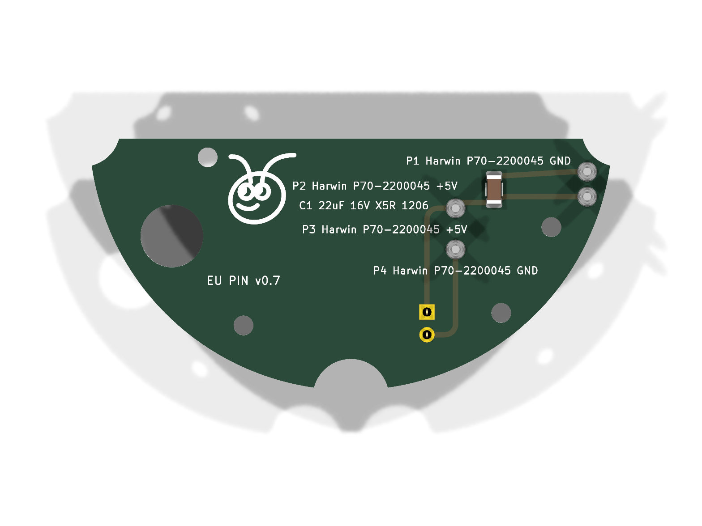 | 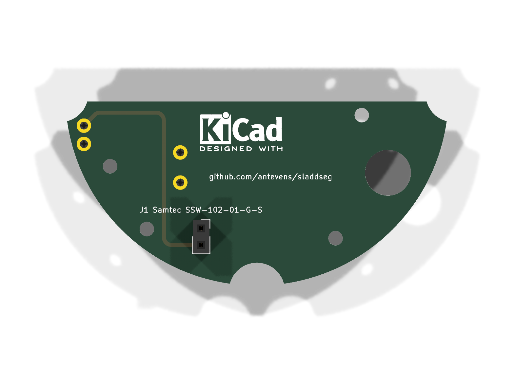 |
| 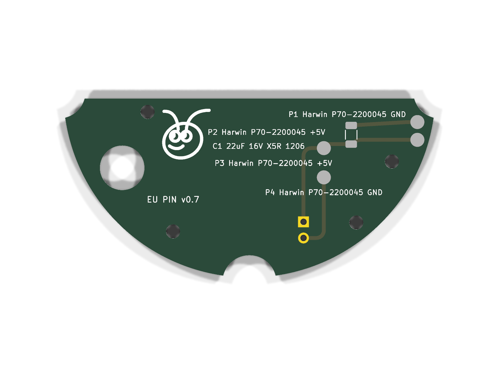 | 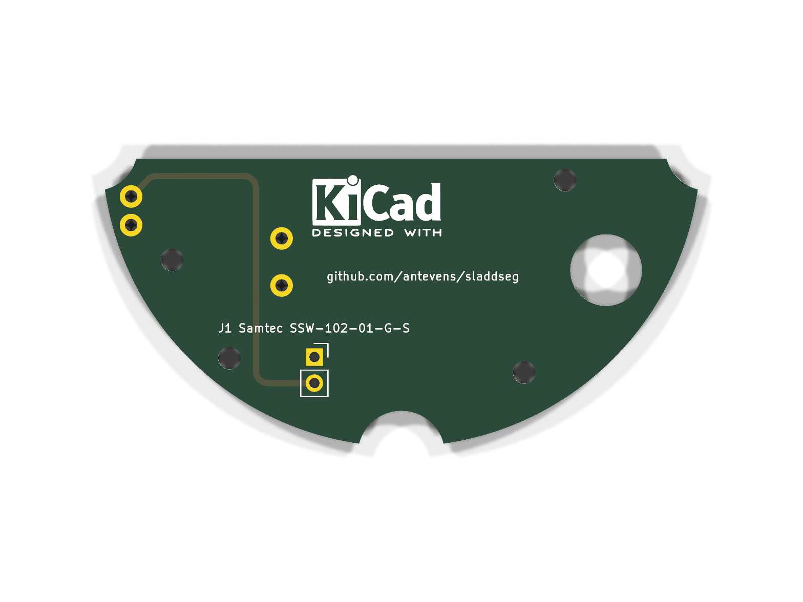 |
| 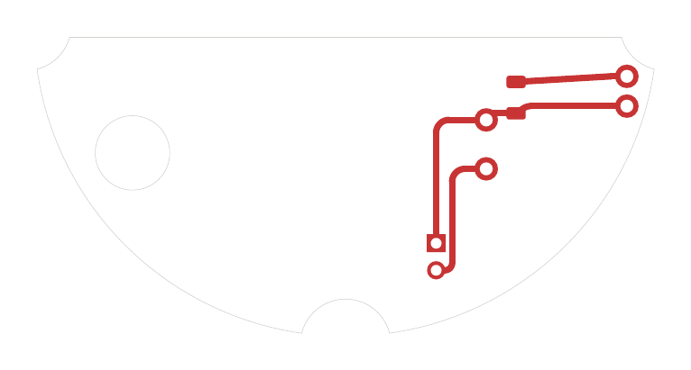 | 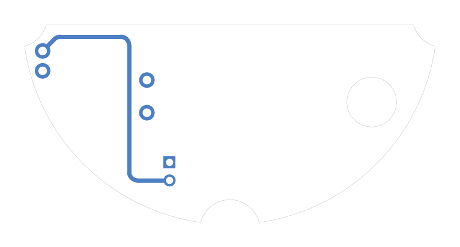 |

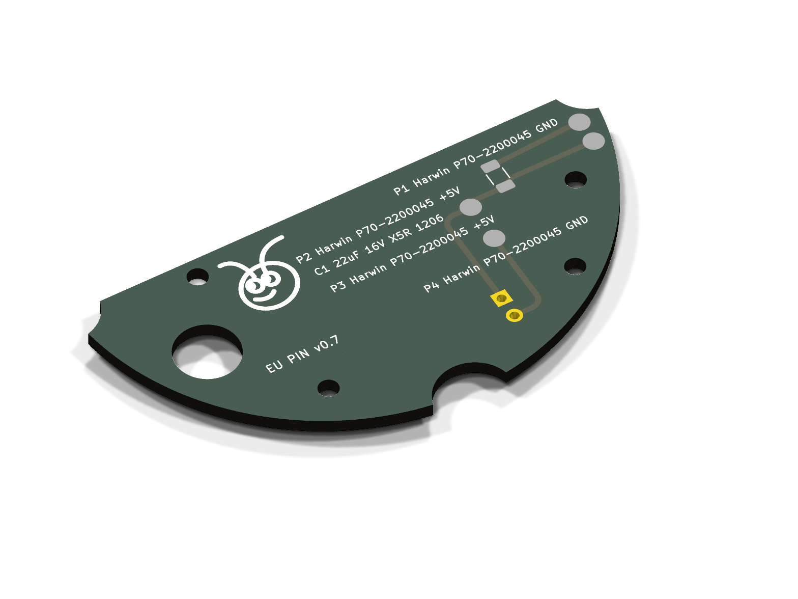

| Sensor board, front | Sensor board, back |
| --- | --- |
| 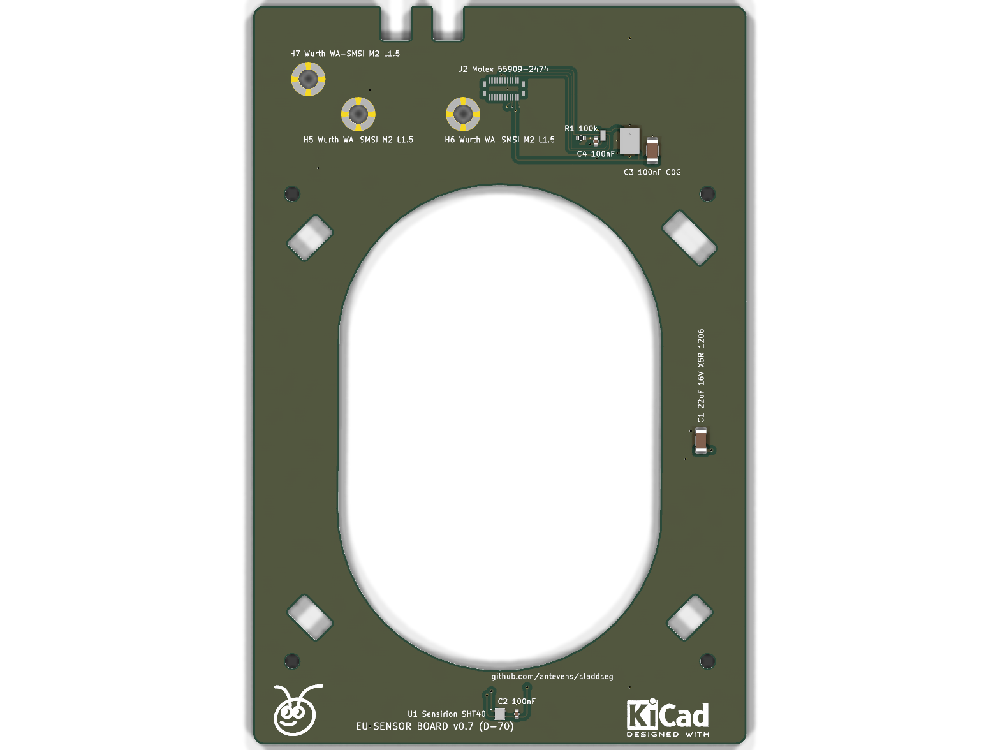 | 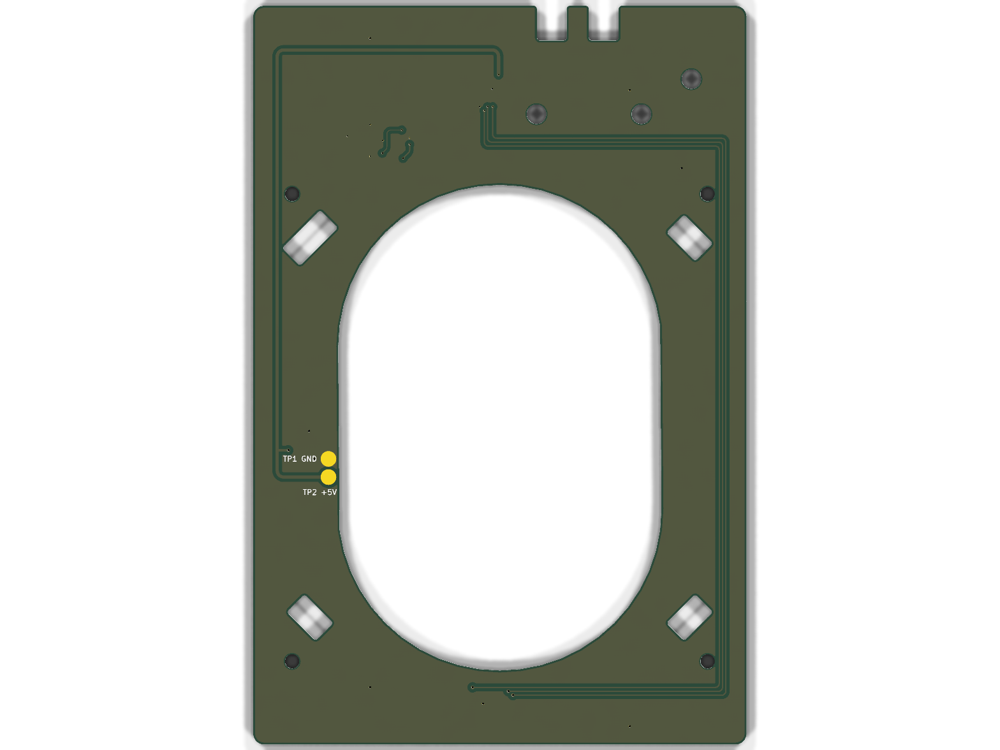 |
| 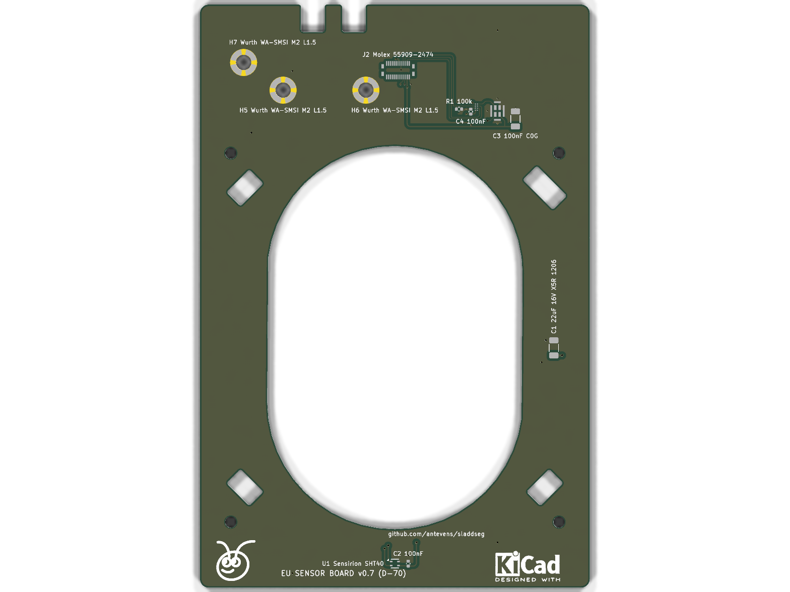 | 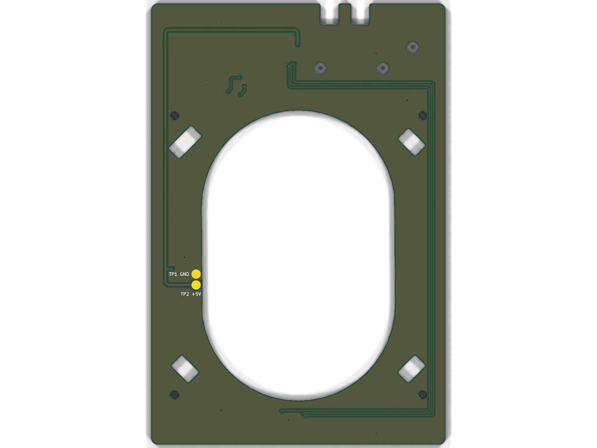 |
| 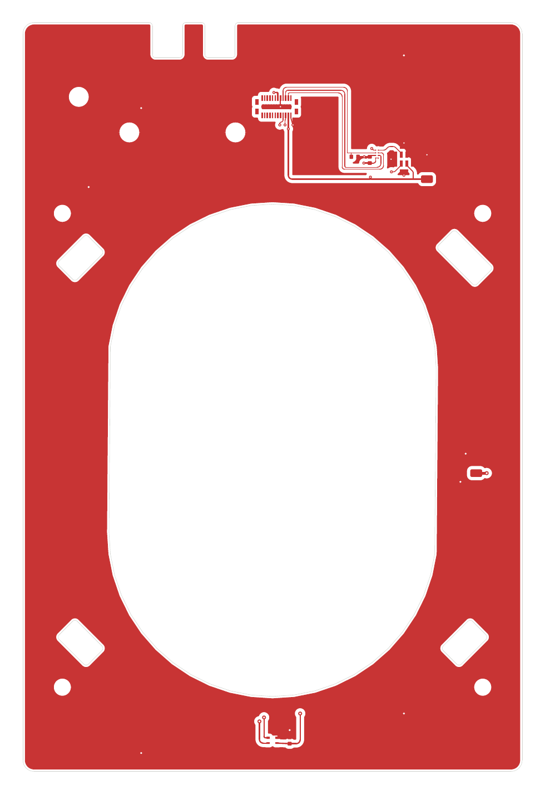 |  |

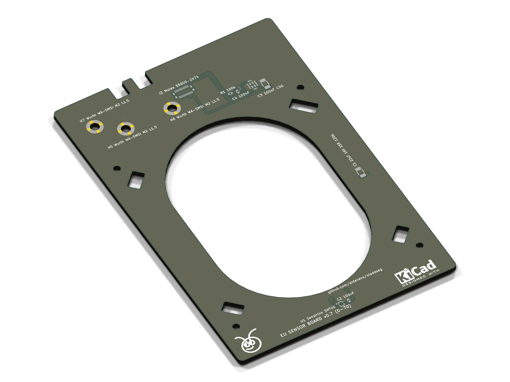
