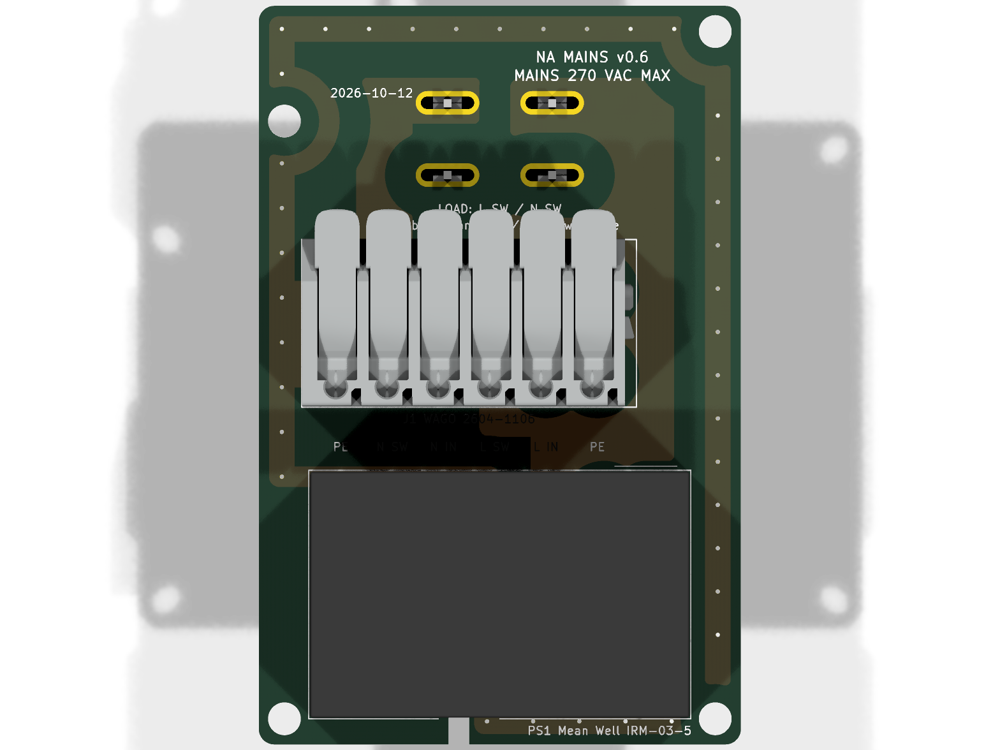
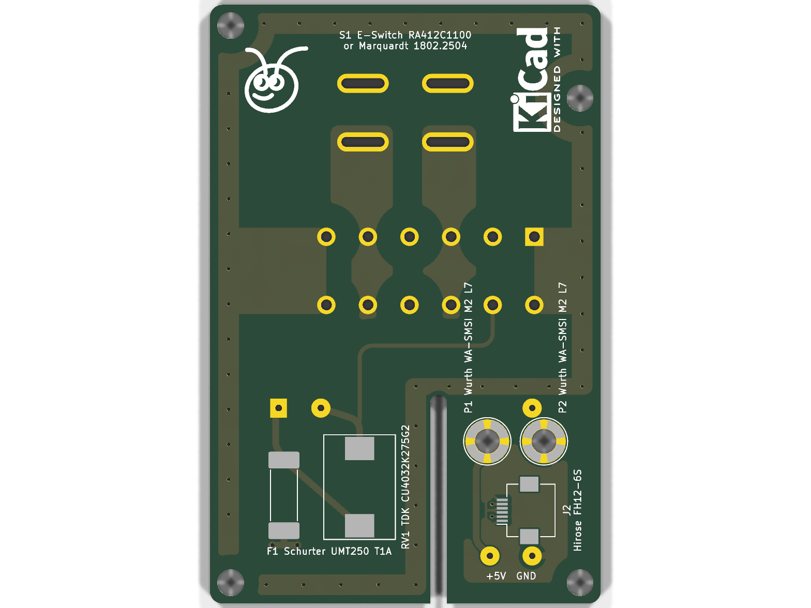
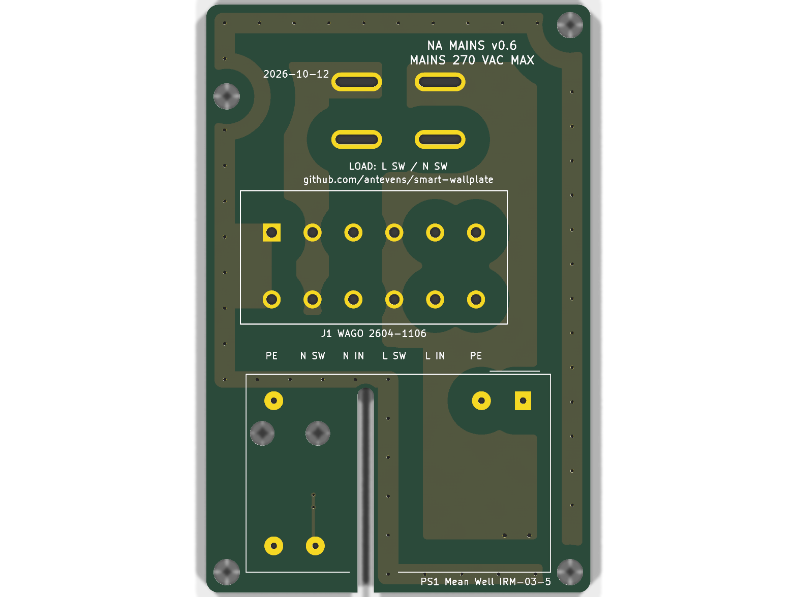
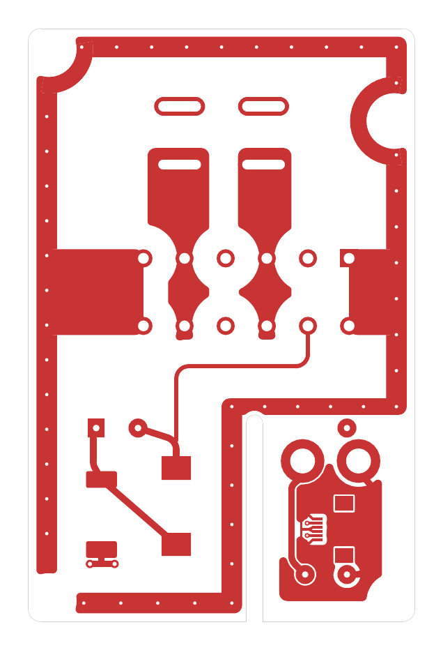
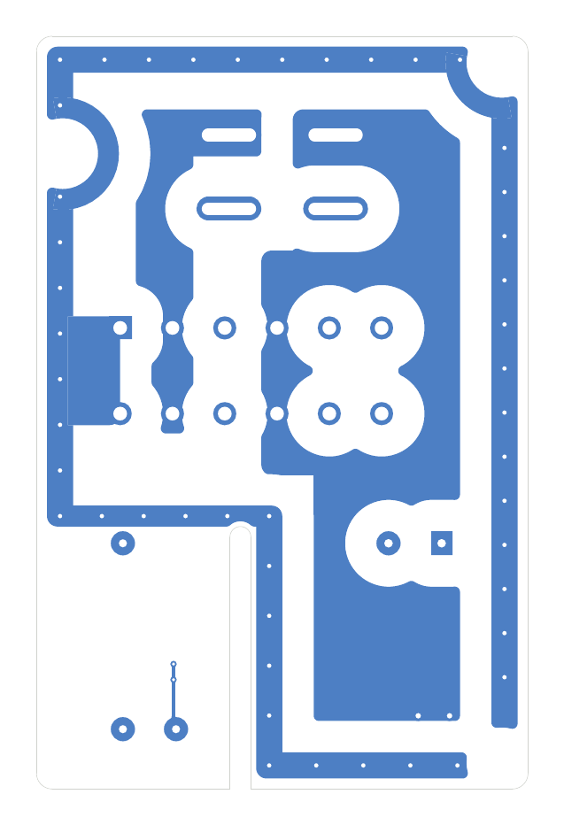
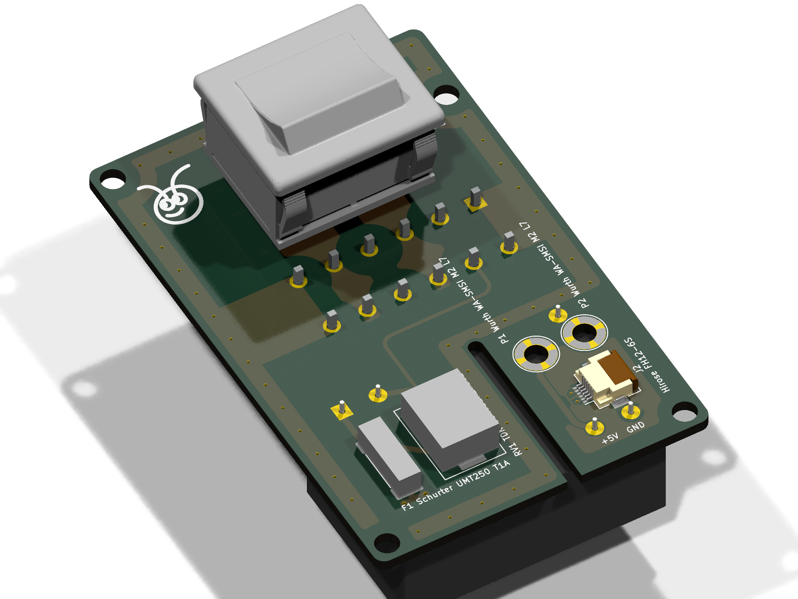
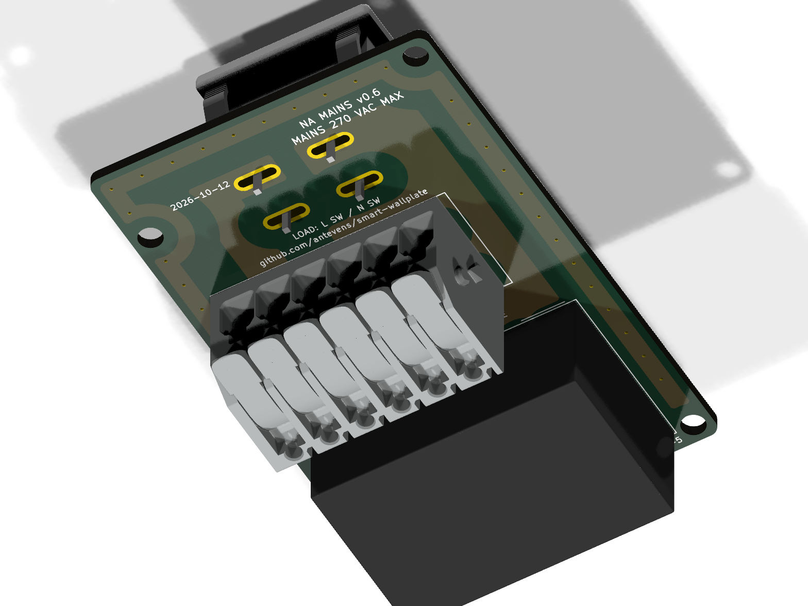
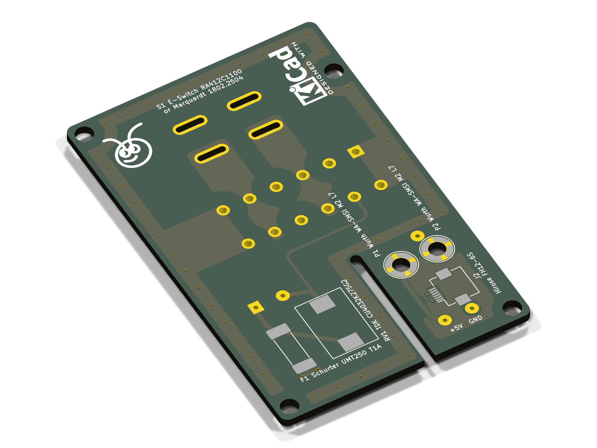

# NA boards (v0.6)

The North American plate's boards (single-gang box, Decora): the mains board, the sensor board and the pin board. The
mains board comes from `tools/` (`parts_na.py`, docs/DESIGN.md D-24, D-25, D-26); the sensor board and the pin board
from `../shared/tools/gen_lv.py na` with their parts in `tools/lv_parts_na.py` (D-50, D-68). Geometry shared with the
CAD comes from `cad/build123d/params.py` and `cad/build123d/na/params_na.py`. The back cover's flex, the same for both
variants, is in `../shared/README.md`.

Spacing values are design targets for human review. Nothing here is a compliance claim, and nothing on these boards
has been checked by a third party.

## Mains board (`kicad/na_mains_board.*`, fab pack in `fab/na_mains_board/`)

The NA plate's board (docs/DESIGN.md D-24, D-25, D-26): the house wiring terminal block, the emergency rocker switch
that breaks line and neutral, and the PSU fed from the switched side.

### Layout

Coordinates are front view in millimetres: X right, Y up toward the rocker, origin at
the board centre. F faces the plate, B faces the box.

- Board: 47 x 72 x 1.6 mm, corner radius 1.5 mm.
- Routed slot: 5 mm wide at X 3.0, from the bottom edge up to Y -10.9, under PS1.
- PE ring on both layers round the AC part, with stitching vias about every 4 mm. Earth
  continuity does not depend on vias or on copper the posts press on: on F.Cu alone, J1.6 ->
  left edge -> round MH1 -> top -> round MH3 -> J1.1 is one piece of copper, and `gen_pcb_na.py`
  fails the build if it is not (checked with the vias left out). The ring detours round MH1
  and MH3 on the inside; MH2 interrupts the ring's bottom-left corner (the lower part stays joined
  to both arms). B.Cu is a parallel ring joined to J1.6 by the vias.
- PE arms from the ring to J1.6 (left, F) and J1.1 (right, F and B): 10.4 mm wide, flush with
  the outer edges of the pin pair's pads (row distance 8.2 plus the 2.2 mm pad),
  ending square at the pins' centre line so the pads keep the 3.0 mm to the neighbouring
  L / N terminals.
- Pours that compete for copper have fixed priorities (line over neutral), so the fill is
  the same on every rebuild.
- 5 V area: bottom right (X 7 to 19.5, Y -33.5 to -13), GND pour on F.
- Mounting holes for the barrier's nylon standoffs (D-57), 3.2 mm, all unplated: MH1 (-21, 33.5),
  MH2 (-21, -33.5), MH3 (21, 24.77), MH4 (21, -33.5). A rule area keeps all copper 3.39 mm
  from each hole on both layers (the standoff's hex and the screw head bear on bare laminate). At MH2 / MH4
  the screw heads reach into PS1's courtyard margin, 1.35 mm clear of its body: a DRC rule allows it and
  `make check` tests the heads against the board STEP.
  Board-only footprints, not in the BOM or centroid. Mains copper keeps 1.0 mm from holes.

### Parts

| Ref | Part | MPN | Side, position | Source |
| --- | --- | --- | --- | --- |
| S1 | Marquardt rocker, DPST, PCB pins (second source: E-Switch RA412C1100, 4.8 mm tabs, D-88) | 1802.2504 | F, (0, 19.5), turned 90 degrees | Marquardt drawing 1802.2504 rev g (K-drawing 18022504.03); E-Switch RA4 datasheet |
| J1 | WAGO PCB terminal block, 6-pole, 5 mm, lever | 2604-1106 | B, pin 1 at (15.5, 8.1) and (15.5, -0.1) | <https://www.wago.com/global/pcb-terminal-blocks-and-pluggable-connectors/pcb-terminal-block/p/2604-1106> |
| PS1 | Mean Well AC-DC module, 5 V 600 mA | IRM-03-5 | B, under the slot | <https://www.meanwell.com/Upload/PDF/IRM-03/IRM-03-SPEC.PDF> |
| F1 | Schurter UMT 250 SMD fuse, T1A 250 VAC | 3403.0166.11 | F, (-14.6, -23) | <https://us.schurter.com/bundles/snceschurter/epim/_ProdPool_/newDS/en/typ_UMT_250.pdf> |
| RV1 | TDK SMD varistor 275 VAC | B72660M0271K093 (CU4032K275G2) | F, (-5.5, -22) | <https://www.farnell.com/datasheets/2921094.pdf> |
| P1, P2 | Würth WA-SMSI SMT spacer M2, 7 mm (spacer posts for the pin board, D-50, D-59, D-60) | 9774070243R | F, (9.85, -16.5), (16.65, -16.5) | <https://www.we-online.com/catalog/datasheet/9774070243R.pdf> |
| J2 | Hirose FH12 FPC connector, 6 contacts, 0.5 mm, slide lock, 5 V out to the sensor board's FFC | FH12-6S-0.5SH(55) | F, (13.5, -24.8), turned 90: FFC out to the right | <https://www.hirose.com/product/en/products/FH12/FH12-6S-0.5SH(55)/> |

S1 data from the drawing:

- Contacts 1-1a and 2-2a.
- Holes 1.3 (+0.1) mm on a 10.2 x 7 mm grid as mounted. Here plated slots 5.2 x 1.2 mm (pads 6.2 x 2.3) on
  10.2 x 7.05 mm, so the same footprint takes the E-Switch RA412C1100 (D-88): 4.8 x 0.8 tabs along x, rows 7.1
  apart, same 22 x 19.2-19.4 cutout, body 12.2 mm deep, tab tips 18.4 mm below the panel (0.6 mm through the board
  at the 16.2 seat), rocker 6.0 mm above the panel; snapped in whichever way round puts its tabs on the slots.
- Body 22 x 18.6 mm below the panel, flange 24 x 21 mm.
- PCB seat 16.2 mm below the panel face; rocker 5.3 mm above it.
- Marked ratings: ENEC 12(4) A 250 V~; UL/CSA 15 A 125-250 VAC.
- The drawing is not in the repository.

### Nets

| Net | Class | Connects |
| --- | --- | --- |
| /L_IN | Mains_L | J1.5, S1.1 |
| /L_SW | Mains_L | J1.4, S1.1a, F1.1 |
| /L_F | Mains_L | F1.2, PS1.1 (AC/L), RV1.1 |
| /N_IN | Mains_N | J1.3, S1.2 |
| /N_SW | Mains_N | J1.2, S1.2a, PS1.3 (AC/N), RV1.2 |
| /PE | PE | J1.1, J1.6, PE ring |
| +5V | SELV | PS1.16, P1, J2.2, J2.5 (mirror-symmetric pinout: an FFC flipped either way keeps the polarity) |
| GND | SELV | PS1.14, P2, J2.1, J2.3, J2.4, J2.6 |

S1 pin positions (front view): L_IN (-5.1, 19.5), L_SW (-5.1, 26.55), N_IN (5.1, 19.5),
N_SW (5.1, 26.55) (slot centres; 1802.2504 pins at 26.5, RA4 tabs at 26.6). Pins 1 / 2 lie on the body's centre line, 1a / 2a 7 mm off it (drawing
1802.2504 rev g), so the body is centred on the in pins.

Load current path:

- Line: J1.5 to S1.1 on F, then S1.1a to J1.4 on B. The B pour runs from J1.4 up into the band between J1's
  upper pin row and the rocker's in pins, and in parallel down under J1 and up the left edge. F1 takes L_SW
  through two vias below it; the fused line runs from F1.2 to PS1.1 and straight across to RV1.1.
- Neutral: J1.3 to S1.2 on F, then S1.2a to J1.2 on B. The B path runs up the right side.

### Rules

The rules are in `kicad/na_mains_board.kicad_dru`, written by `tools/gen_project_na.py`.

- L to N: 3.0 mm.
- L_IN to L_SW and L_F: 3.0 mm.
- N_IN to N_SW: 3.0 mm.
- Any two different mains nets: 3.0 mm (covers switched line to fused line across F1).
- Mains to PE: 3.0 mm.

(`MAINS_GAP` in `tools/parts.py`: IEC 60664-1 OVC III clearance 3.0 mm; on high-CTI FR4, CTI ≥ 600, the creepage need
drops to about 1.6 mm, so clearance sets the target. Order the board in high-CTI FR4, D-102.)
- Mains to SELV: 8.0 mm clearance and creepage, with the routed slot.
- Mains to the PSU NC pin: 8.0 mm.
- Mains copper to board edge: 1.0 mm; other copper 0.5 mm.
- Pads of one footprint keep the part's own spacing. This is the exception for
  certified parts.

Creepage is checked only for mains to SELV. On this flat board the surface path
between copper on one layer is never shorter than the straight gap, so the 3.0 mm
targets are checked as clearance. KiCad evaluates creepage rules without the
footprint, so a per-part creepage exception cannot be written.

### Status

Done:

- Generators for the libraries, the project and rules, the schematic, the board and the
  3D envelopes.
- Placement, outline and slot, PE ring with stitching vias, pours, tracks and silkscreen.
- All nets routed.
- ERC: 0 errors, 0 warnings.
- DRC (`--severity-all --schematic-parity`): 0 violations, 0 unconnected, 0 parity issues.
- STEP model in `build/na_mains_board.step`; PCBWay order pack in `fab/`; renders in
  `docs/renders/na_mains_board_*.png` (`make renders`).

Open:

- Meter-check the S1 pin numbering on a sample. The drawing's side view labels the
  pins 1a / 1 / 1b.
- RA412C1100 (D-88): which two of the RA4's three tab rows (centre, ±7.1) the DPST version has, on a sample.
  Centre and one end: fits, snapped in that way round. Both ends: the third row lands over J1 (y 12.4).
- Check the J1 pin rows on a part. They come from WAGO's 3D model (rows y 8.1 and -0.1,
  8.2 apart, D-37).
- Thermal review of the 15 A paths. The 3.0 mm targets to the neighbouring J1 pads (round,
  2.2 mm, 5 mm pitch) leave 1.6 to 1.8 mm of pour beside each pad (N_SW 1.3 mm, beside
  the PE arm) over the 2 to 3 mm where the pours leave J1. Options are 2 oz copper, or
  different targets between in and switched terminals of one pole.
- S1's body sits on the front over J1's first pin row: pad edge 1.0 mm from the body
  outline (`PAD_BODY_GAP`, checked by `make check` for every through-hole pad against the
  bodies on the other side). J1's levers overhang the S1 pins 13.9 mm or more above the
  board.
- F1 rating (T1A) is a designer's choice. Its 200 A breaking capacity at 250 VAC
  needs review against the branch circuit's prospective fault current.
- RV1 pad gap: the datasheet's D = 10.1 mm does not match B + C + B; the larger gap
  is used.
- The 22 uF output capacitor is on the sensor board at J1 (D-50).
- P1 / P2 carry the pin board and its 5 V: the WA-SBRIE studs' 5 mm male thread ends inside the 7 mm spacer, short of the board and the PSU behind it (`make check`).

### Renders

With components, then without (every trace and pour), then the copper layers (back seen from behind).

| Front | Back |
| --- | --- |
|  |  |
|  |  |
|  |  |

| Front, angled | Back, angled |
| --- | --- |
|  |  |



## Sensor board (`kicad/na_sensor_board.*`)

FR4 1.6 mm, two layers, round the barrier's collar against the wall, pressed onto its crush ribs (D-68)
(outline 66.3 × 125.9 mm, window 53.9 × 79.3 mm with a notch round each screw boss; two notches in the top edge
under the MSR-2's Boot / RST switches, which stand deeper behind its board than the CN2 stack, D-64). Seen from the
front (F faces the barrier):

- J1: Hirose FH12-6S for the 5 V FFC from the mains board's J2; GND 1, 3, 4, 6, +5V 2, 5 (the
  same mirror-symmetric pinout as J2, so the FFC's type and orientation cannot swap the polarity).
  C1 22 µF at J1.
- J2: Molex 55909-2474 (24 contacts, 0.4 mm) mating the MSR-2's rear connector CN2 (D-82); land pattern from Molex
  SD-55909-003 rev J (D-89); contact map and pin 1 placeholders, below.
- U1: SHT40 with C2 (100 nF) under the face plate's vents at the bottom.
- MK1: Knowles SPK0641HT4H-1 (top-port PDM microphone, SELECT low) at the top right, port end up under the face
  plate's sound column; U2: Analog Devices ADAU7002 (PDM to I²S, CONFIG high = I²S, WLCSP-8 0.4 mm) to its left with
  C4 (100 nF), R1 (100 kΩ I²S SD pull-down: SDATA is tristated between words) and C3 (the mic's 100 nF, C0G 1206, D-85) outside the
  column's gasket (D-83). The I²S lanes run from CN2's upper row into U2 (SD straight in on the left, WS and SCK
  under it and up its right); PDM_CLK goes to the mic on the front, PDM_DAT on the back; a +3V3 bus under the parts
  feeds the mic and C3. The mic's GND ring pads that the signal escapes enclose (5, 6) have their own vias.
- H1–H3: Würth WA-SMSI M2 L1.5 SMT spacers (9774015243R, Ø5.3 pad on a Ø3.0 unplated hole, GND)
  under the MSR-2's board, below the face plate's posts (D-68).

Copper keeps 8 mm along the wall from the box opening (rule areas: front 6.4 mm in plan, the board
edge adds 1.6; back 8.0). So the back layer only has the bands above and below the box; the right
side carries three front lanes (SCL, SDA, +3V3; 0.15 mm, 0.33 mm pitch) round the box's corner to the
SHT40, the left side a GND pour that joins the top and bottom pours. SDA, SCL and +3V3 cross the top
band on the back, under J1, to three vias above the rail; the I²S lanes and +5V stay on the front. Vias 0.45 / 0.2 mm
round CN2 and U2.

**Not ready to fabricate.** J2's contact map and pin 1 are placeholders: CN2's part is assumed (D-82: Molex
55909-2474 on the MSR-2's 51338-2474, 1.5 mm mated); the land pattern is Molex's (SD-55909-003 rev J sheet 2:
pads 0.22 × 0.9 at 0.4, rows 1.73 apart, four 0.5 × 0.85 fitting nail pads, D-89), but the drawing numbers no pins. `CN2_MAP` only keeps the
fan-out from crossing. `tools/build.sh` writes no sensor board fab files while `CN2_CONFIRMED` is false.

## Pin board (`kicad/na_pin_board.*`, fab pack in `fab/na_pin_board/`)

FR4 0.8 mm, two layers, 14 × 12 mm, in a pocket under the barrier's pocket floor (D-53, D-60, D-79). P1 / P2: M2 pads
(Ø3.8 on a plated Ø2.2 hole, under the pan heads) over the two spacer posts at its lower corners (P1 +5V, P2 GND), held by
M2 × 5 screws, which carry the current through the WA-SBRIE studs. J1 / J2: Harwin P70-2200045 SMT
spring pins with pegs (Ø2.2 pad over a plated Ø1.2 hole; +5V above, GND below) above and between the posts, at the
back cover's pad positions. 1 mm tracks.

## 5 V FFC

Stock: GCT 05-06-A-0152-A-4-06-4-G or Würth WR-FFC 687606152002 (0.5 mm, 6 contacts, 152 mm, Type 1; D-98). Mains board J2 → the straight bore in the
barrier's top-right corner (D-74) → out of the flange onto the sensor board → sensor board J1, both latched (FH12 slide
lock); the spare length lies folded flat in four layers (12 mm) at y 43.4, between the flange and J1 (D-68). Assembly:
with the mains board on its standoffs, push the end up the bore from the barrier's underside round its one bend into
the slot and latch it into J2 from the side; press the sensor board onto the collar's crush ribs (no screws, D-68), pull
the cable taut from the face side, fold the spare, latch J1.

## Regenerate

```bash
make pcb        # every board; or pcb/na/tools/build.sh for the NA boards alone
```

`tools/build.sh` writes the 3D models (`../tools/gen_3d.py`), then the mains board: `gen_libs_na.py` (libraries),
`gen_project_na.py` (project seed and DRC rules), `gen_schematic_na.py`, `gen_pcb_na.py` (board and zone fill); then
the sensor board and the pin board (`../shared/tools/gen_lv.py na`). It runs ERC and DRC on all three (reports in
`build/`), exports the mains board's STEP to `build/na_mains_board.step` and writes the PCBWay packs:
`fab/na_mains_board/` (`gen_fab_na.py` writes the BOM and the centroid; S1 is not fitted) and `fab/na_pin_board/`. The
sensor board's fab files wait for the CN2 contact map.

## Renders

Each board with components, without them, and its copper layers (back seen from behind). The mains board's are above.

| Sensor board, front | Sensor board, back |
| --- | --- |
|  |  |
|  |  |
|  |  |


| Pin board, front | Pin board, back |
| --- | --- |
|  |  |
|  |  |
|  |  |


