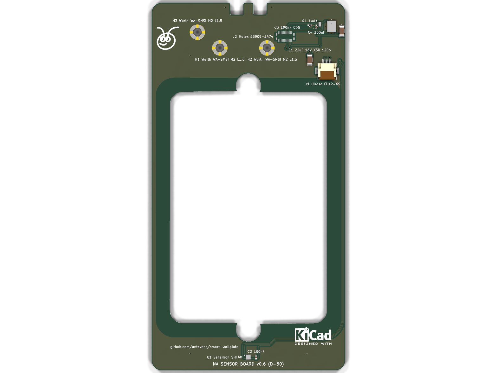
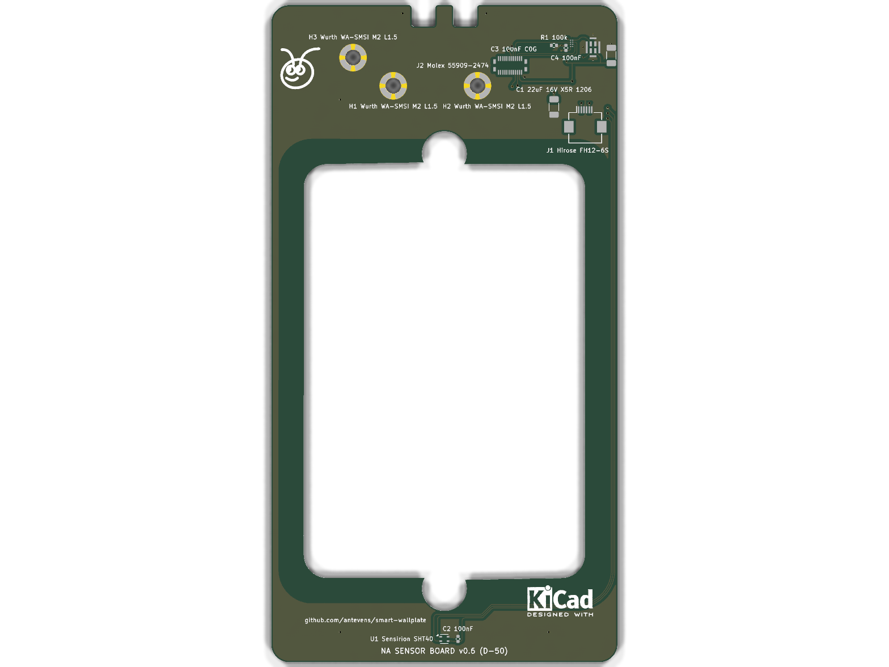
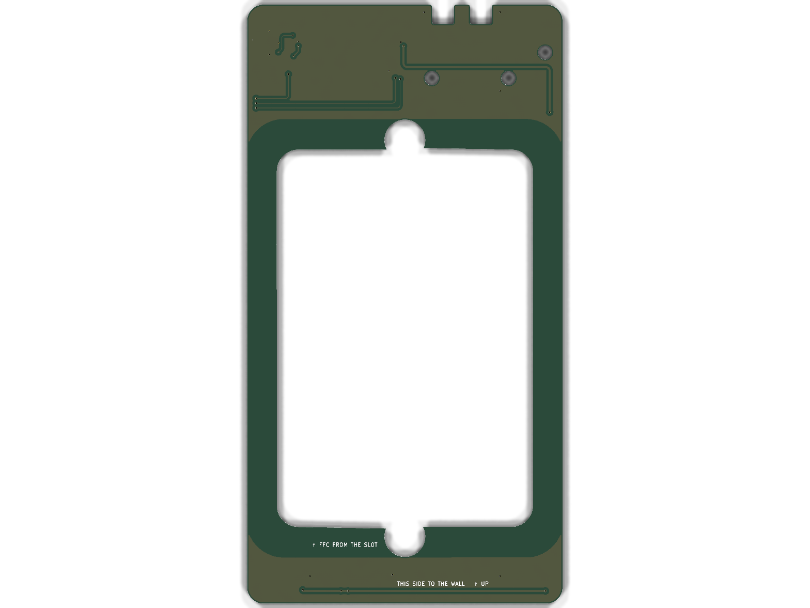
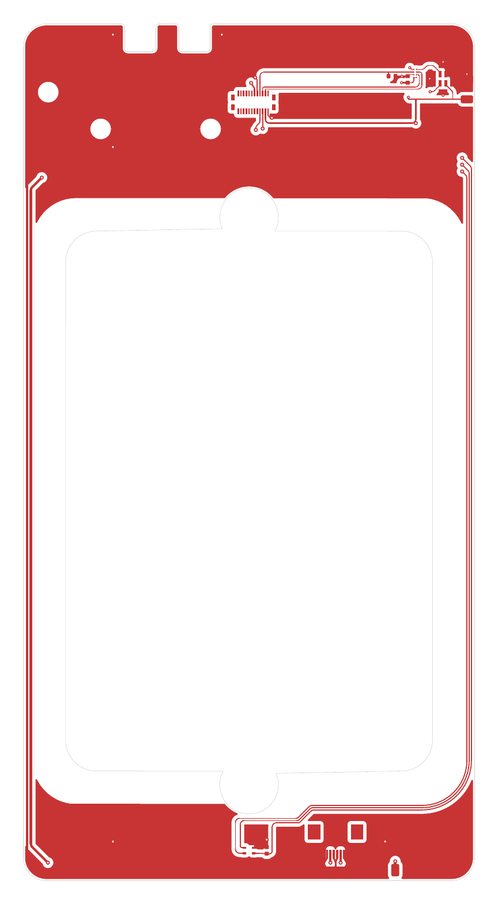
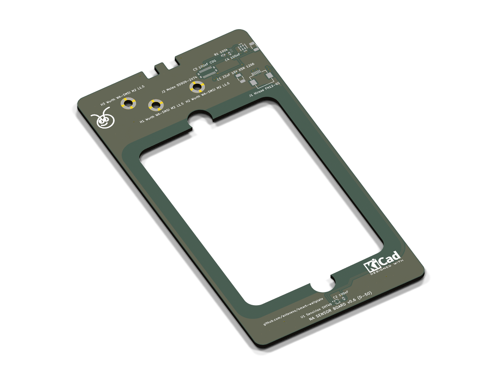
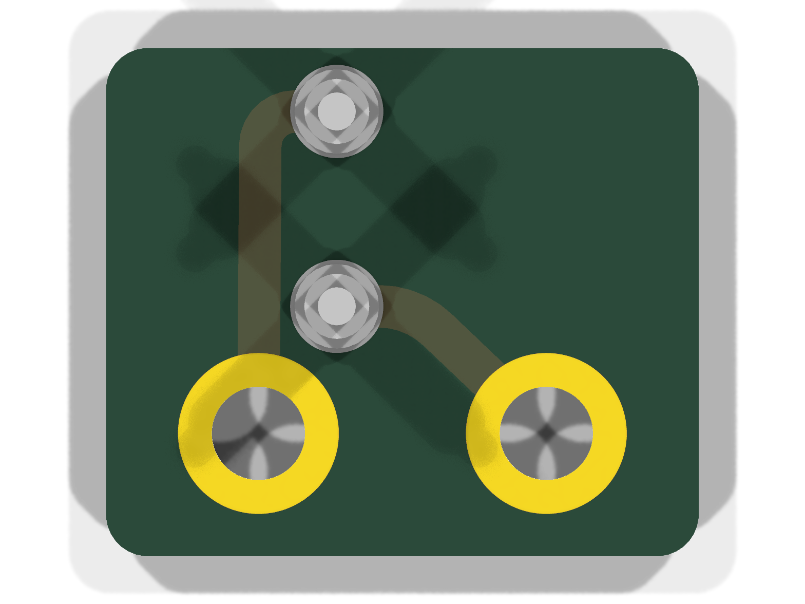
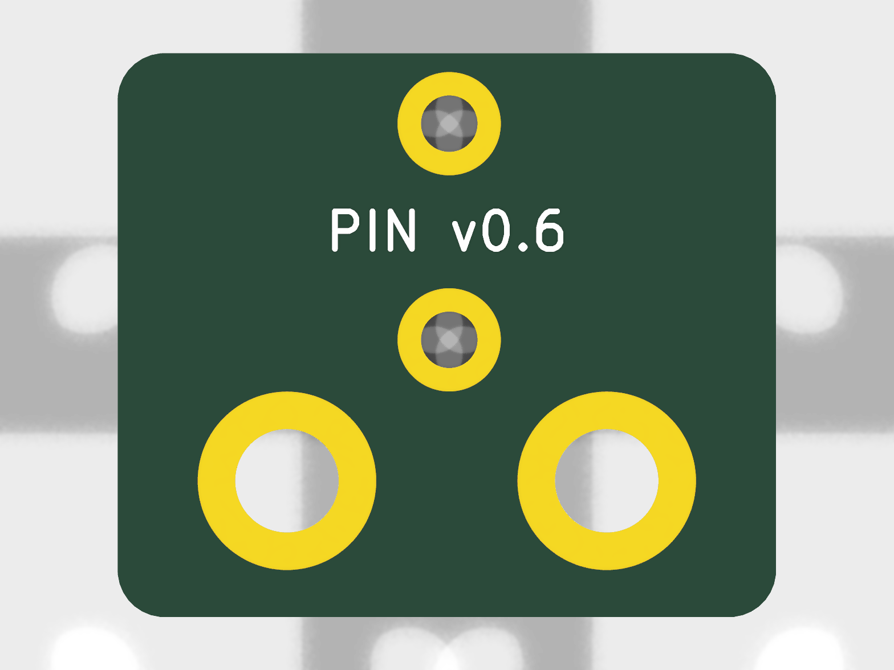
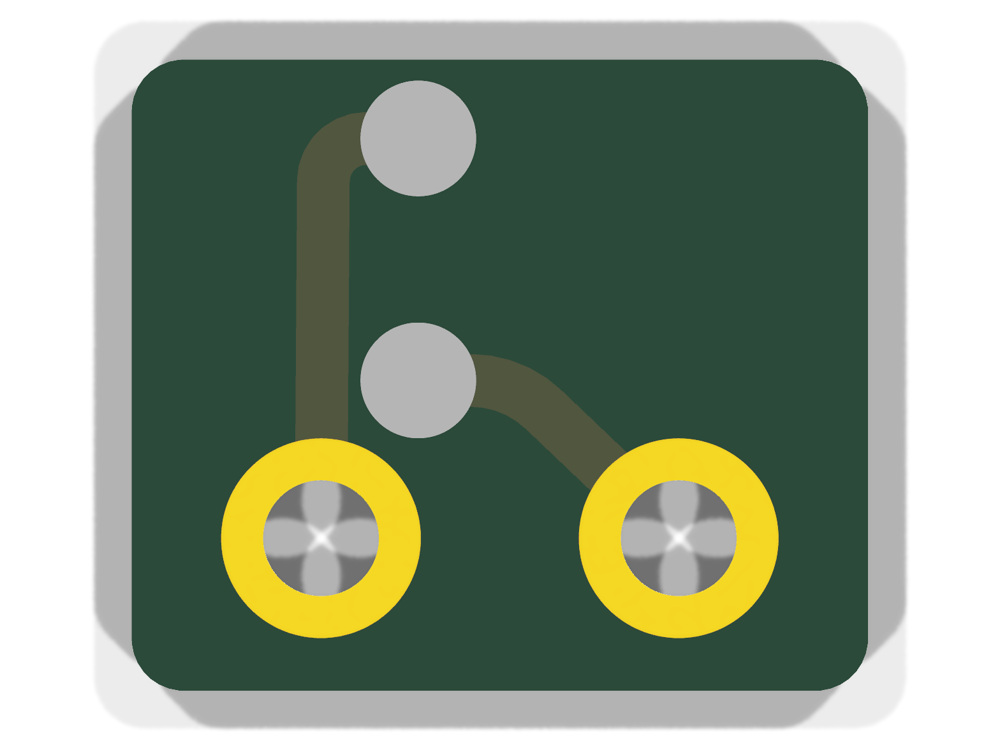
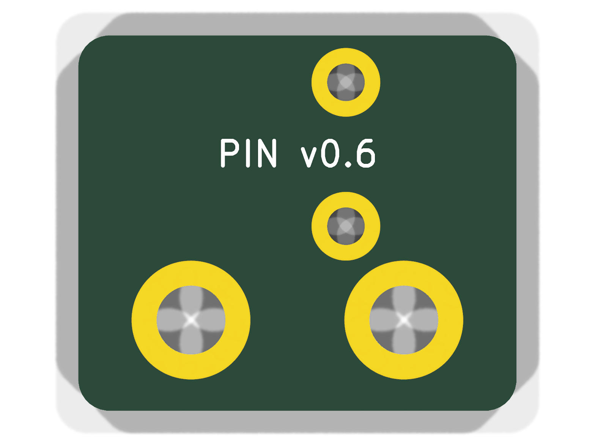
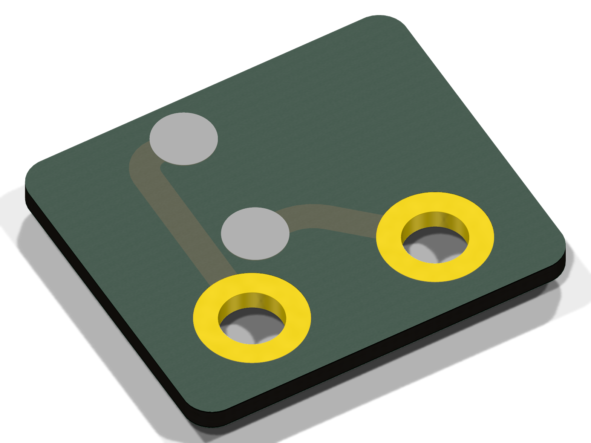

# NA boards (v0.7)

The North American plate's boards (single-gang box, Decora): the mains board, the sensor board and the pin board. The
mains board comes from `tools/` (`parts_na.py`, docs/DESIGN.md D-24, D-25, D-26); the sensor board and the pin board
from `../shared/tools/gen_lv.py na` with their parts in `tools/lv_parts_na.py` (D-50, D-68). Geometry shared with the
CAD comes from `cad/build123d/params.py` and `cad/build123d/na/params_na.py`. The back cover's flex, the same for both
variants, is in `../shared/README.md`.

Spacing values are design targets for human review. Nothing here is a compliance claim, and nothing on these boards
has been checked by a third party.

## Mains board (`kicad/na_mains_board_busbar.*`, fab pack in `fab/na_mains_board_busbar/`)

The NA plate's board (docs/DESIGN.md D-24, D-25, D-26, D-153): the house wiring terminal block, the emergency rocker
switch that breaks line and neutral, and the PSU fed from the switched side. The load runs in four laser-cut copper
bars soldered on the front between J1 and S1, so the board copper does not set the current (D-153; the earlier board
with the load in pours on high-CTI FR4 is dropped, D-155). Built by `gen_pcb_na.py busbar` (with
`gen_project_na.py busbar` and `gen_schematic_na.py busbar`); `tools/bars_na.py` (CAD Python) draws the bars round the
pads (`build/na_mains_board_pads.json`), checks their clearances and writes `kicad/na_mains_board_busbar_bars.json`
(their lands: copper with no solder mask) and the DXF for the laser cutter.

### Layout

Coordinates are front view in millimetres: X right, Y up toward the rocker, origin at
the board centre. F faces the plate, B faces the box.

- Board: 47 x 72 x 1.6 mm, corner radius 1.5 mm, standard FR4, 2 oz, HASL lead-free.
- Routed slot under PS1: closed, 2 mm wide, both ends round, stopping 5.5 mm above the bottom edge so the PE ring
  closes under it. Every mains copper stays 8 mm from the 5 V side by straight line, so the slot only adds.
- Bars (0.5 mm copper, tin plated), on the front, only between J1 and S1: L_IN / N_IN straight up from their pole
  (1.4 mm between the poles), then straight sides out to the rocker pad's lower corners; N_SW from J1.2 up the right
  of the rocker onto S1.2a; L_SW from J1.4 down, round J1.5 and J1.6 at 3.2 mm, up the left and over the top onto
  S1.1a. Each bar covers its rocker pad and its terminal pole's pads with a hole per pin. Narrowest bar 1.4 mm:
  0.70 mm², about 21 A at 10 °C rise (IPC-2221). Their lands are board copper of the same outline with no solder
  mask; vias inside a land are left open.
- Thin feeds in board copper (under 1 A, `BB_TRACKS`): J1.2 → B → via → RV1.2 → PS1.3; a via in the L_SW land → B →
  via → F1.1.
- PE ring: a 7 mm band round the front edge and all free copper on the back, arms to J1.1 / J1.6, 22 stitching vias
  (1.3 / 0.8 mm, 5 mm grid); continuous on B.Cu alone (the L_SW bar runs between J1.6 and the left edge on the
  front). Narrowest PE: front 2.87 mm, back 4.60 mm over the top, 2.08 mm under the slot: at 2 oz about 27 A at
  10 °C rise and about 1.5 kA for one cycle before it melts.
- 5 V area: bottom right (X 7 to 19.5, Y -33.5 to -13), GND pour on F.
- Mounting holes for the barrier's nylon standoffs (D-57), 3.2 mm, all unplated: MH1 (-21, 33.5),
  MH2 (-21, -33.5), MH3 (21, 33.5), MH4 (21, -33.5). A rule area keeps all copper 3.39 mm
  from each hole on both layers (the standoff's hex and the screw head bear on bare laminate). At MH2 / MH4
  the screw heads reach into PS1's courtyard margin, 1.35 mm clear of its body: a DRC rule allows it and
  `make check` tests the heads against the board STEP.
  Board-only footprints, not in the BOM or centroid. Mains copper keeps 1.0 mm from holes.

### Parts

| Ref | Part | MPN | Side, position | Source |
| --- | --- | --- | --- | --- |
| S1 | Marquardt rocker, DPST, PCB pins (second source: E-Switch RA412C1100, 4.8 mm tabs, D-88) | 1802.2504 | F, (0, 19.5), turned 90 degrees | Marquardt drawing 1802.2504 rev g (K-drawing 18022504.03); E-Switch RA4 datasheet |
| J1 | WAGO PCB terminal block, 6-pole, 5 mm, lever | 2604-1106 | B, pin 1 at (15.5, 8.1) and (15.5, -0.1) | <https://www.wago.com/global/pcb-terminal-blocks-and-pluggable-connectors/pcb-terminal-block/p/2604-1106> |
| PS1 | Mean Well AC-DC module, 5 V 600 mA | IRM-03-5 | B, under the slot | <https://www.meanwell.com/Upload/PDF/IRM-03/IRM-03-SPEC.PDF> |
| F1 | Schurter UMT 250 SMD fuse, T1A 250 VAC | 3403.0166.11 | F, (-14.6, -23) | <https://us.schurter.com/bundles/snceschurter/epim/_ProdPool_/newDS/en/typ_UMT_250.pdf> |
| RV1 | TDK SMD varistor 275 VAC | B72660M0271K093 (CU4032K275G2) | F, (-5.5, -22) | <https://www.farnell.com/datasheets/2921094.pdf> |
| P1, P2 | Würth WA-SMSI SMT spacer M2, 7 mm (spacer posts for the pin board, D-50, D-59, D-60) | 9774070243R | F, (9.85, -16.5), (16.65, -16.5) | <https://www.we-online.com/catalog/datasheet/9774070243R.pdf> |
| J2 | Hirose FH12 FPC connector, 6 contacts, 0.5 mm, slide lock, 5 V out to the sensor board's FFC | FH12-6S-0.5SH(55) | F, (12.7, -23.3), 0°: FFC out downwards to the barrier's slit (D-134) | <https://www.hirose.com/product/en/products/FH12/FH12-6S-0.5SH(55)/> |

S1 data from the drawing:

- Contacts 1-1a and 2-2a.
- Holes 1.3 (+0.1) mm on a 10.2 x 7 mm grid as mounted. Here plated slots 5.2 x 1.2 mm (pads 6.2 x 2.3) on
  10.2 x 7.05 mm, so the same footprint takes the E-Switch RA412C1100 (D-88): 4.8 x 0.8 tabs along x, rows 7.1
  apart, same 22 x 19.2-19.4 cutout, body 12.2 mm deep, tab tips 18.4 mm below the panel (0.6 mm through the board
  at the 16.2 seat), rocker 6.0 mm above the panel; snapped in whichever way round puts its tabs on the slots.
- Body 22 x 18.6 mm below the panel, flange 24 x 21 mm.
- PCB seat 16.2 mm below the panel face; rocker 5.3 mm above it.
- Marked ratings: ENEC 12(4) A 250 V~; UL/CSA 15 A 125-250 VAC.
- The drawing is not in the repository.

### Nets

| Net | Class | Connects |
| --- | --- | --- |
| /L_IN | Mains_L | J1.5, S1.1 |
| /L_SW | Mains_L | J1.4, S1.1a, F1.1 |
| /L_F | Mains_L | F1.2, PS1.1 (AC/L), RV1.1 |
| /N_IN | Mains_N | J1.3, S1.2 |
| /N_SW | Mains_N | J1.2, S1.2a, PS1.3 (AC/N), RV1.2 |
| /PE | PE | J1.1, J1.6, PE ring |
| +5V | SELV | PS1.16, P1, J2.2, J2.5 (mirror-symmetric pinout: an FFC flipped either way keeps the polarity) |
| GND | SELV | PS1.14, P2, J2.1, J2.3, J2.4, J2.6 |

S1 pin positions (front view): L_IN (-5.1, 19.5), L_SW (-5.1, 26.55), N_IN (5.1, 19.5),
N_SW (5.1, 26.55) (slot centres; 1802.2504 pins at 26.5, RA4 tabs at 26.6). Pins 1 / 2 lie on the body's centre line, 1a / 2a 7 mm off it (drawing
1802.2504 rev g), so the body is centred on the in pins.

Load current path: in the bars on the front, J1.5 → S1.1 (L_IN), S1.1a → J1.4 (L_SW), J1.3 → S1.2 (N_IN), S1.2a →
J1.2 (N_SW). F1 hangs off the L_SW land and the PSU's neutral off J1.2 in board copper; the fused line runs from F1.2
to PS1.1 and across to RV1.1.

### Rules

The rules are in `kicad/na_mains_board_busbar.kicad_dru`, written by `tools/gen_project_na.py busbar`.

- L to N: 3.2 mm.
- L_IN to L_SW and L_F: 3.2 mm.
- N_IN to N_SW: 3.2 mm.
- Any two different mains nets: 3.2 mm (covers switched line to fused line across F1).
- Mains to PE: 3.2 mm.

(`BB_GAP`: IEC 60664-1 creepage at the 320 V row, pollution degree 2, material group III (standard FR4), 3.2 mm,
above the OVC III clearance of 3.0 mm; D-153. Between the pins of the WAGO block its own pitch applies.)
- Mains to SELV: 8.0 mm clearance and creepage, with the routed slot.
- Mains to the PSU NC pin: 8.0 mm.
- Mains copper to board edge: 1.0 mm; other copper 0.5 mm.
- Pads of one footprint keep the part's own spacing. This is the exception for
  certified parts.

Creepage is checked only for mains to SELV. On this flat board the surface path
between copper on one layer is never shorter than the straight gap, so the 3.2 mm
targets are checked as clearance. KiCad evaluates creepage rules without the
footprint, so a per-part creepage exception cannot be written.

### Status

Done:

- Generators for the libraries, the project and rules, the schematic, the board and the
  3D envelopes.
- Placement, outline and slot, PE ring with stitching vias, pours, tracks and silkscreen.
- All nets routed.
- ERC: 0 errors, 0 warnings.
- DRC (`--severity-all --schematic-parity`): 0 violations, 0 unconnected, 0 parity issues.
- STEP model in `build/na_mains_board_busbar.step`; PCBWay order pack with the bars' DXF in
  `fab/na_mains_board_busbar/`; renders in `docs/renders/na_mains_board_busbar_*.png` (`make renders`).

Open:

- Meter-check the S1 pin numbering on a sample. The drawing's side view labels the
  pins 1a / 1 / 1b.
- RA412C1100 (D-88): which two of the RA4's three tab rows (centre, ±7.1) the DPST version has, on a sample.
  Centre and one end: fits, snapped in that way round. Both ends: the third row lands over J1 (y 12.4).
- Check the J1 pin rows on a part. They come from WAGO's 3D model (rows y 8.1 and -0.1,
  8.2 apart, D-37).
- Thermal review of the bars (narrowest 1.4 mm, 0.70 mm²) and of the PE ring at 2 oz for the branch circuit's
  fault current (D-153).
- The rocker's pin stems over the bars: on a sample, whether the 1802.2504's stems reach the board at the pads (our
  model of its drawing says they do); the bars lift it by 0.5 mm plus solder (D-153).
- The room between the board's front and the barrier for the bars: the bars are not in the CAD yet (D-153).
- WAGO 2604 pin size against the bars' 1.3 mm holes (MEASURE on a part).
- S1's body sits on the front over J1's first pin row: pad edge 1.0 mm from the body
  outline (`PAD_BODY_GAP`, checked by `make check` for every through-hole pad against the
  bodies on the other side). J1's levers overhang the S1 pins 13.9 mm or more above the
  board.
- F1 rating (T1A) is a designer's choice. Its 200 A breaking capacity at 250 VAC
  needs review against the branch circuit's prospective fault current.
- RV1 pad gap: the datasheet's D = 10.1 mm does not match B + C + B; the larger gap
  is used.
- The 22 uF output capacitor is on the sensor board at J1 (D-50).
- P1 / P2 carry the pin board and its 5 V: the WA-SBRIE studs' 5 mm male thread ends inside the 7 mm spacer, short of the board and the PSU behind it (`make check`).

### Renders

With components, then without (every trace and pour), then the copper layers (back seen from behind).

| Front | Back |
| --- | --- |
|  |  |
|  |  |
|  |  |


Dropped board (D-155), its files still in the tree until backlog item 4 removes them: `kicad/na_mains_board.*`,
`fab/na_mains_board/`, `build/na_mains_board.step` and the renders `docs/renders/na_mains_board_front.png`,
`docs/renders/na_mains_board_back.png`, `docs/renders/na_mains_board_bare_front.png`,
`docs/renders/na_mains_board_bare_back.png`, `docs/renders/na_mains_board_copper_front.png`,
`docs/renders/na_mains_board_copper_back.png`, `docs/renders/na_mains_board_iso_front.png`,
`docs/renders/na_mains_board_iso_back.png`, `docs/renders/na_mains_board_bare_iso.png`.

## Sensor board (`kicad/na_sensor_board.*`)

FR4 1.6 mm, two layers, round the barrier's collar against the wall, pressed onto its crush ribs (D-68)
(outline 66.3 × 125.9 mm, window 53.9 × 79.3 mm with a notch round each screw boss; two notches in the top edge
under the MSR-2's Boot / RST switches, which stand deeper behind its board than the CN2 stack, D-64). Seen from the
front (F faces the barrier):

- J1: Hirose FH12-6S for the 5 V FFC from the mains board's J2; GND 1, 3, 4, 6, +5V 2, 5 (the
  same mirror-symmetric pinout as J2, so the FFC's type and orientation cannot swap the polarity).
  At the bottom, (12.7, -50.0), 180°: cable in from above, over the mains board's J2 (D-134). C1 22 µF beside it.
  +5V to CN2: on the back along the bottom band, on the front up the left edge (0.35 mm, outside the keep-out) beside
  a 0.3 mm GND track, on the back across the top band.
- J2: Hirose DF40C-24DP-0.4V(51) (24 contacts, 0.4 mm) mating the MSR-2's rear connector CN2, a DF40C-24DS-0.4V(51)
  (D-154); land pattern from Hirose's DF40 catalog; contact map from Apollo's schematic; pin 1 at the left end of the
  lower row (from Apollo's boards).
- U1: SHT40 with C2 (100 nF) under the face plate's vents at the bottom.
- MK1: Knowles SPK0641HT4H-1 (top-port PDM microphone, SELECT low) at the top right, port end up under the face
  plate's sound column; U2: Analog Devices ADAU7002 (PDM to I²S, CONFIG high = I²S, WLCSP-8 0.4 mm) to its left with
  C4 (100 nF), R1 (100 kΩ I²S SD pull-down: SDATA is tristated between words) and C3 (the mic's 100 nF, C0G 1206, D-85) outside the
  column's gasket (D-83). The I²S lanes run from CN2's signal row into U2 (SD straight in on the left, WS and SCK
  under it and up its right); PDM_CLK goes to the mic on the front, PDM_DAT on the back; a +3V3 bus under the parts
  feeds the mic and C3. The mic's GND ring pads that the signal escapes enclose (5, 6) have their own vias.
- H1–H3: Würth WA-SMSI M2 L1.5 SMT spacers (9774015243R, Ø5.3 pad on a Ø3.0 unplated hole, GND)
  under the MSR-2's board, below the face plate's posts (D-68).

Copper keeps 8 mm along the wall from the box opening (rule areas: front 6.4 mm in plan, the board
edge adds 1.6; back 8.0). So the back layer only has the bands above and below the box; the right
side carries three front lanes (SCL, SDA, +3V3; 0.15 mm, 0.33 mm pitch) round the box's corner to the
SHT40, the left side a GND pour that joins the top and bottom pours. SDA, SCL and +3V3 cross the top
band on the back, under J1, to three vias above the rail; the I²S lanes stay on the front. At CN2 (D-154) every used
contact but +5V is on the lower row: the I²S lanes go down, right and up round the header's right end, SCL and SDA
down and out past the header's ends to vias, +3V3 down to a via and on the back to the mic's parts, +5V up from the
upper row to a via; GND 1 / 2 / 4 and 23 / 24 to two vias between the rows. Vias 0.45 / 0.2 mm round CN2 and U2.

**Fit-test prototype.** CN2's part, contact map and pin 1 are Apollo's (D-154: Hirose DF40C-24DS-0.4V(51) on the
MSR-2, DF40C-24DP-0.4V(51) here, 1.5 mm mated; land pattern from Hirose's DF40 catalog p. 7: pads 0.23 × 0.66 at 0.4,
rows 3.37 outside / 2.05 inside, four 0.35 × 0.66 corner bracket pads; pin 1 from the add-on's mark and the MSR-2's
traces), but CN2's position on the MSR-2 (`MSR_CN2_IN`) is a photo estimate.

## Pin board (`kicad/na_pin_board.*`, fab pack in `fab/na_pin_board/`)

FR4 0.8 mm, two layers, 14 × 12 mm, in a pocket under the barrier's pocket floor (D-53, D-60, D-79). P1 / P2: M2 pads
(Ø3.8 on a plated Ø2.2 hole, under the pan heads) over the two spacer posts at its lower corners (P1 +5V, P2 GND), held by
M2 × 5 screws, which carry the current through the WA-SBRIE studs. J1 / J2: Harwin P70-2200045 SMT
spring pins with pegs (Ø2.2 pad over a plated Ø1.2 hole; +5V above, GND below) above and between the posts, at the
back cover's pad positions. 1 mm tracks.

## 5 V FFC

Stock: GCT 05-06-A-0050-A-4-06-4-G or Würth WR-FFC 687606050002 (0.5 mm, 6 contacts, 50 mm, Type 1; D-134). Mains board J2
(cable out downwards) → the slit in the barrier's bottom wall → sensor board J1 (at its bottom, cable in from above), both
latched (FH12 slide lock), all in the plane x 12.7: a 3 mm bend up out of J2, one straight run through the slit, a 4 mm
bend over onto the sensor board. Assembly: latch J2 before fitting the mains board; press the sensor board onto the
collar's crush ribs (no screws, D-68); bend the cable to shape, slide it sideways into the slit through its notch,
latch J1.

## Regenerate

```bash
make pcb        # every board; or pcb/na/tools/build.sh for the NA boards alone
```

`tools/build.sh` writes the 3D models (`../tools/gen_3d.py`), then the mains board: `gen_libs_na.py` (libraries),
`gen_project_na.py` (project seed and DRC rules), `gen_schematic_na.py`, `gen_pcb_na.py` (board and zone fill), in
`busbar` mode, and `bars_na.py` (the bars); then the sensor board and the pin board (`../shared/tools/gen_lv.py na`).
It runs ERC and DRC on all three (reports in `build/`), exports the mains board's STEP to
`build/na_mains_board_busbar.step` and writes the PCBWay packs: `fab/na_mains_board_busbar/` (`gen_fab_na.py` writes
the BOM and the centroid, `bars_na.py` the bars' DXF; S1 and the bars are not fitted) and `fab/na_pin_board/`. The
sensor board's PCBWay files are a fit-test prototype (D-154). The dropped board's mode of the same generators still
runs (backlog item 4).

## Renders

Each board with components, without them, and its copper layers (back seen from behind). The mains board's are above.

| Sensor board, front | Sensor board, back |
| --- | --- |
|  |  |
|  |  |
|  |  |



| Pin board, front | Pin board, back |
| --- | --- |
|  |  |
|  |  |
|  |  |


