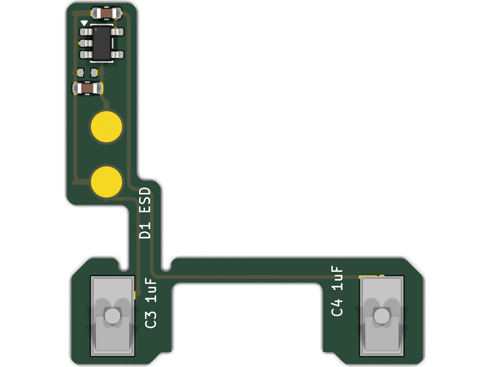
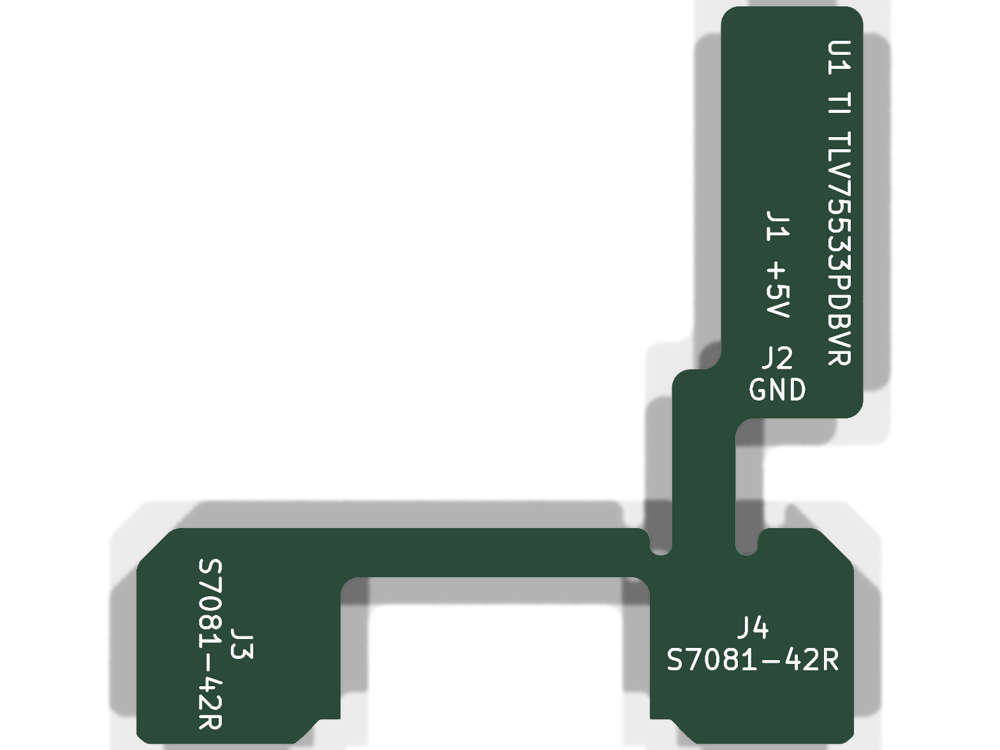

# Shared board (v0.6)

The replacement back cover's flex (D-35, D-50), the same board in both variants, and the generator for every
low-voltage board: `tools/gen_lv.py na|eu|shared` writes the NA sensor and pin boards into `../na/kicad/`, the EU
sensor board into `../eu/kicad/` and the cover flex into `kicad/`, each folder with the low-voltage library (`lv.pretty`,
`lv.kicad_sym`). Parts both variants share (the CN2 mate, the microphone and its parts, footprints, the flex) are in
`tools/lv_parts.py`; each variant's boards in `../na/tools/lv_parts_na.py` and `../eu/tools/lv_parts_eu.py`. Geometry
comes from `cad/build123d/params.py` (the CAD model is in `cad/build123d/backcover.py`).

Nothing here touches mains.

## Back cover flex (`kicad/cover_flex.*`)

Single copper layer, polyimide, for the replacement back cover that powers a BILRESA E2490
without cells (`cad/build123d/backcover.py`, DESIGN D-35). Drawn flat, seen from the copper side.

- J1, J2: gold pads (+5V, GND) on the pad section, which lies copper down on a ledge in the
  cover, behind Ø2.1 windows in its back: the plate's spring pins press on them (NA, D-50). Ø3.0 copper
  under a Ø2.6 coverlay opening: the coverlay holds the pad's edge (D-116).
- A 2.6 mm run (in a notch along the GND contact post's inner face, D-79) to the terminal end; one 90°
  bend, inside r 0.6 mm (6 × the 0.10 mm flex), copper outside, with a relief slit either side of the
  run so the rest of the end section reaches down to the ledge (D-116). The tracks cross the bend zone
  straight; the +3V3 lane turns 0.85 mm past it.
- J1 takes +5 V from the plate (D-41, D-50); D1 TI TPD1E10B06DYAR (ESD) on +5V; U1 TI TLV75533PDBVR (3.3 V,
  SOT-23-5) with C3 / C4 1 µF 0603 X5R (0.85 µF or more at their working voltages) on the regulator section,
  copper down in a recess in the cover (0.4 mm wall left), feeds VBAT (D-116).
- A 0.8 mm FR4 stiffener (back side) on the pad and regulator sections, flush with their long
  edges: five snap hooks in the cover hold it down against the pins' push (D-45, D-79); 0.15 mm under
  the hooks for the stiffener's tolerance and adhesive (D-116). No holes.
- Coverlay openings 0.1 mm beyond the pads, one opening over each pin row of U1 / D1; teardrops where the
  tracks leave the pads (D-116).
- J3, J4: Harwin S7081-42R spring fingers (VBAT, GND) on the end section, on the cell axes, long
  axis vertical with the bend end up (the battery contacts ride down the arm's ramp as the cover
  goes on), on a 0.4 mm FR4 stiffener (back side), notched round the run 0.76 mm past the bend zone; it slides
  down slots along the contact blocks (D-55). The end section stands 2.0 mm (the fingers'
  working height) in from the cell end plane: J3 presses the remote's fixed VBAT plate, J4 its GND
  leaf spring (finger and leaf share the travel). Between them only a band passes under the
  remote's PCB strip.

Not ready to fabricate: the positions come from the FCC internal photos (REF) or are MEASURE;
`tools/build.sh` writes no `fab/cover_flex/` while `COVER_CONFIRMED` is false.

## Microphone firmware (D-29, D-83)

ESPHome on the MSR-2, push-to-talk: Home Assistant starts listening (for example from a BILRESA
button automation calling the action) and the voice pipeline ends it on silence. Untested
starting point:

```yaml
i2s_audio:
  - id: i2s_mic_bus
    i2s_lrclk_pin: GPIO6
    i2s_bclk_pin: GPIO4

microphone:
  - platform: i2s_audio
    id: plate_mic
    i2s_audio_id: i2s_mic_bus
    adc_type: external
    i2s_din_pin: GPIO7
    channel: left              # SELECT low: check which slot carries the mic on an MSR-2
    bits_per_sample: 32bit     # ADAU7002: 20-bit data in 32-bit slots, BCLK = 64 x fs
    sample_rate: 16000         # PDM clock 64 x fs = 1.024 MHz: the mic's performance mode starts at 1.0 MHz

voice_assistant:
  microphone: plate_mic

api:
  actions:
    - action: start_listening
      then:
        - voice_assistant.start:
    - action: stop_listening
      then:
        - voice_assistant.stop:
```

Open: whether the pipeline accepts 48 kHz from this microphone on the C3 or needs 32 kHz, and
the C3's RAM / CPU headroom next to the radar, Wi-Fi and BLE.

## Regenerate

```bash
make pcb        # every board; or pcb/shared/tools/build.sh for the cover flex alone
```

`tools/build.sh` writes the 3D models and the cover flex (`tools/gen_lv.py shared`), runs ERC and DRC (all severities,
schematic parity; reports in `build/`) and writes `fab/cover_flex/` once its positions are measured
(`COVER_CONFIRMED`).

## Open

- CN2 mate (Molex 55909-2474, D-82, D-89): contact map and pin 1 (from the GPIO add-on's plug or Apollo). Then set
  `CN2_CONFIRMED`, regenerate, check the fan-out. The pads' mask webs are 0.18 mm (PCBWay: 0.19 green): one opening
  per row.
- The FFC passes through the mains volume to the barrier's slit (SAFETY item 4).
- MK1 and U2 pin 1 against parts (footprints from the datasheets' top views).
- Microphone firmware test on an MSR-2 (sample rate, I²S slot, load).

## Renders

The cover flex with components, without them, and its copper layer.

| Back cover flex, copper side | Back cover flex, stiffener side |
| --- | --- |
|  |  |
|  |  |


